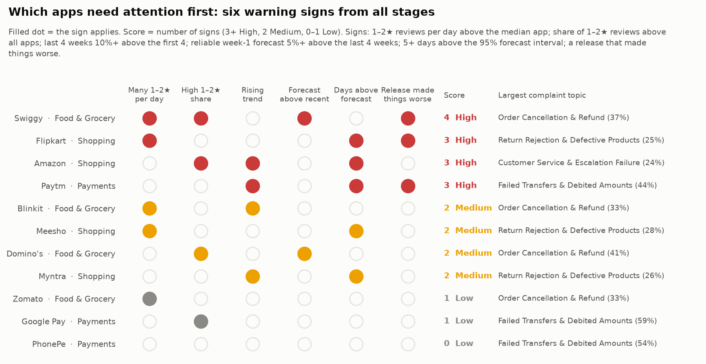

# Combined Business Insights and Recommendations — Review 2

**Capstone Project — Review 2 (Unit 3): Combined insights (#141)**
*Input: the outputs of every earlier stage (1,137,987 reviews, 11 apps, 1 Apr – 20 Sep 2026)*

The question: putting the text mining, time-series, update-impact and classifier results together, which apps need attention first, and what exactly should each team do?

Code: `scripts/22_combined_insights.py` (a few seconds; needs scripts 15, 19, 20 and 21 and the text-mining outputs). Tables in `data/combined/`, chart in `data/charts/combined/`, numbers in `data/combined_insights_summary.json`. The dashboard's Recommendations page shows the same tables, filterable by domain and app.

---

## 1. What is joined

| Source stage | File | Used for |
| ------------ | ---- | -------- |
| Time-series data (#131) | `data/timeseries/daily_app.csv`, `patterns_by_app.csv` | 1–2★ reviews per day, 1–2★ share (feed-gap days excluded), trend (last 4 weeks vs first 4), busiest weekday |
| Text mining (#134, #136) | `data/textmining/topic_share_by_app.csv`, `topic_sentiment_by_app.csv` | Largest complaint topic and its VADER sentiment; most damaging topic (most negative, at least 10% of the app's complaints) |
| Forecasting (#135, #137) | `data/timeseries/forecast_weekly.csv`, `evaluation_metrics_by_app.csv`, `unusual_days_unique.csv` | Week-1 forecast (21–27 Sep) with 80% interval, change vs last 4 weeks, MASE vs seasonal naive, days above the 95% interval |
| Update impact (#138) | `data/update_impact/impact_by_app.csv`, `worse_releases.csv` | Releases tested, releases that made things worse, worst release and its elevated issue |
| Classifier (Review 1) | `data/model_predictions.csv.gz`, `data/model_results_by_group.csv` | Random Forest flag rate on the test set, precision, recall and PR-AUC per app |

A forecast is treated as **reliable** only if ARIMA beat the seasonal-naive baseline in the backtest and the week-1 change is within ±30%. Paytm (week 1 −61%, after the September jump) and Google Pay (backtest MAE 10.9 against 6.2 for the seasonal-naive baseline) are unreliable, so their forecasts do not count as a warning sign and their capacity advice says to use last week's level instead.

## 2. Priority rule

Each app scores one point per warning sign (0–6). **3 or more = High, 2 = Medium, 0–1 = Low.**

| Warning sign | Rule |
| ------------ | ---- |
| Many 1–2★ per day | 1–2★ reviews per day above the median of the 11 apps (103) |
| High 1–2★ share | Share of 1–2★ reviews (feed-gap days excluded) above the all-app share (18.9%) |
| Rising trend | Last 4 weeks at least 10% above the first 4 weeks |
| Forecast above recent | Reliable week-1 forecast at least 5% above the last 4 weeks |
| Days above forecast | At least 5 days above the 95% forecast interval |
| Release made things worse | At least one release flagged as worse in #138 |

The rule is deliberately simple: every point can be traced to one number in one stage, and a manager can check it by hand.

## 3. Priority table (`data/combined/priority_table.csv`)

| App | Domain | Priority (score) | 1–2★ / day | 1–2★ share | Trend | Largest complaint topic (share, sentiment) | Forecast 21–27 Sep (vs last 4 wks) | Days above interval | Releases worse | Classifier flag rate |
| --- | ------ | ---------------- | ---------: | ---------: | ----: | ------------------------------------------ | ---------------------------------- | ------------------: | -------------- | -------------------: |
| Swiggy | Food & Grocery | **High (4)** | 151 | 33.4% | −16% | Order Cancellation & Refund (37%, −0.33) | 1,037 (+7%) | 4 | 2 (4.107.1) | 37.6% |
| Flipkart | Shopping | **High (3)** | 282 | 17.7% | +5% | Return Rejection & Defective Products (25%, −0.21) | 1,830 (−7%) | 18 | 1 (9.3) | 17.4% |
| Amazon | Shopping | **High (3)** | 103 | 53.4% | +14% | Customer Service & Escalation Failure (24%, −0.21) | 714 (−6%) | 9 | 0 | 58.1% |
| Paytm | Payments | **High (3)** | 38 | 14.6% | +60% | Failed Transfers & Debited Amounts (44%, −0.19) | 136 (−61%, unreliable) | 10 | 1 (10.84.5, confirmed) | 18.2% |
| Blinkit | Food & Grocery | Medium (2) | 251 | 18.4% | +13% | Order Cancellation & Refund (33%, −0.22) | 1,711 (−8%) | 3 | 0 | 25.9% |
| Meesho | Shopping | Medium (2) | 104 | 17.6% | +2% | Return Rejection & Defective Products (28%, −0.26) | 737 (+4%) | 9 | 0 | 24.2% |
| Domino's | Food & Grocery | Medium (2) | 60 | 22.6% | −18% | Order Cancellation & Refund (41%, −0.28) | 413 (+7%) | 4 | 0 | 27.2% |
| Myntra | Shopping | Medium (2) | 51 | 10.3% | +22% | Return Rejection & Defective Products (26%, −0.32) | 371 (−10%) | 9 | 0 | 15.1% |
| Zomato | Food & Grocery | Low (1) | 164 | 18.8% | −11% | Order Cancellation & Refund (33%, −0.28) | 977 (−7%) | 0 | 0 | 22.3% |
| Google Pay | Payments | Low (1) | 27 | 23.2% | −20% | Failed Transfers & Debited Amounts (59%, −0.13) | 192 (+3%, unreliable) | 0 | 0 | 29.2% |
| PhonePe | Payments | Low (0) | 50 | 9.8% | +3% | Failed Transfers & Debited Amounts (54%, −0.14) | 348 (−10%) | 1 | 0 | 12.8% |

The full table (59 columns, including the most damaging topic, interval bounds, MASE and MAE, worst unusual day, classifier precision/recall/PR-AUC and the six 0/1 signs) is in the CSV.

## 4. Recommendations (`data/combined/recommendations.csv`)

65 recommendations: 9 at domain level (three per domain) and 56 at app level. Each has a type, an action and the number it rests on.

### 4.1 Per domain

| Domain | Fix first (most common complaint) | Most damaging (angriest topic) | Focus |
| ------ | --------------------------------- | ------------------------------ | ----- |
| Food & Grocery | **Order Cancellation & Refund**: 35% of the domain's topic-assigned 1–2★ reviews (28,656), sentiment −0.27 | **Poor Food Quality & Stale Items**: sentiment −0.44, 59% strongly negative | Swiggy (High). Blinkit has the most complaints: 251 a day |
| Shopping | **Return Rejection & Defective Products**: 25% (18,156), sentiment −0.23 | **Extreme Dissatisfaction & Scam Allegations**: sentiment −0.61, 80% strongly negative | Flipkart and Amazon (High). Flipkart: 282 a day |
| Payments | **Failed Transfers & Debited Amounts**: 52% (6,909), sentiment −0.15 | **Customer Support Unresponsiveness**: sentiment −0.23, 40% strongly negative | Paytm (High). PhonePe has the most complaints: 50 a day, but only 9.8% of its reviews |

What it means for the business:

- **Food & Grocery:** the refund and cancellation flow is the shared weak point (a third of all complaints in every food app). Food quality complaints are fewer but the angriest, so they damage ratings most per review.
- **Shopping:** returns being rejected and defective products are the largest theme in Flipkart, Meesho and Myntra; scam allegations are the most hostile reviews and need a fast, visible response.
- **Payments:** half of all complaints are about money debited but not received. Payment complaints are mild in tone (−0.15) because users describe a transaction; their anger goes to support that does not answer (−0.23).

### 4.2 Per app (High priority)

**Swiggy — High (4 signs)**

- *Fix first:* Order Cancellation & Refund — 37% of its complaints, sentiment −0.33.
- *Most damaging:* Customer Support & Bot Loop — 23% of complaints, sentiment −0.43, 59% strongly negative.
- *Release check:* review 4.107.1 (19 Apr): 60% of reviews on the new version were 1–2★ vs 42% on older versions, 21 points above Swiggy's usual gap; Customer Support complaints +8.9 points. Released in the late-April feed gap, so the shares are inflated, but both groups cover the same days.
- *Plan capacity:* 1,037 1–2★ reviews expected 21–27 Sep (80% interval 889–1,180), +7% vs the last 4 weeks.
- *Triage:* the classifier flags 38% of reviews; 87% of the flags are real 1–2★ reviews and it finds 93% of them.

**Flipkart — High (3 signs)**

- *Fix first:* Return Rejection & Defective Products — 25%, sentiment −0.21.
- *Most damaging:* Extreme Dissatisfaction & Scam Allegations — 10%, sentiment −0.61, 81% strongly negative.
- *Release check:* review 9.3 (16 Apr): 30% vs 16% 1–2★, 8 points above the usual gap; Customer Support +4.2 and Cancellation & Return +3.2 points (feed gap).
- *Monitor:* 18 days above the 95% forecast interval, the most of any app; largest on 4 Jul (451 vs 264 expected). Set a daily alert.
- *Plan capacity:* 1,830 expected (1,596–2,056), −7%.

**Amazon — High (3 signs)**

- *Fix first:* Customer Service & Escalation Failure — 24%, sentiment −0.21.
- *Most damaging:* Extreme Dissatisfaction & Scam Allegations — sentiment −0.59, 77% strongly negative.
- *Trend:* last 4 weeks +14% vs the first 4; 53% of all its reviews are 1–2★, the highest share of the 11 apps.
- *Monitor:* 9 days above the interval; largest 4 Jul (142 vs 98 expected).
- *Triage:* the classifier is most useful here — precision 91%, recall 96%.

**Paytm — High (3 signs)**

- *Release check:* review 10.84.5 (3 Sep) first. It is the only release confirmed at app level: 23% vs 13% 1–2★ on the new version, and the app's 1–2★ reviews per day rose from 34 to 66; 6 forecast alerts in the following week.
- *Fix first:* Failed Transfers & Debited Amounts — 44%, sentiment −0.19.
- *Trend:* last 4 weeks +60% vs the first 4, the fastest rise of any app.
- *Plan capacity:* do not plan on the ARIMA forecast (−61% for week 1, unreliable after the September jump); use last week's level.
- *Triage:* precision is lowest here (66%), so flagged reviews need a human check.

Medium and Low priority apps have the same fix-first, most-damaging, capacity and triage recommendations (see the CSV or the dashboard). Notable ones: Myntra's complaints are rising fastest among the rest (+22%), Blinkit has the second-largest complaint volume (251 a day) and a rising trend, and PhonePe raises no warning sign at all.

## 5. Limits

- The priority score weights every sign equally and uses fixed thresholds (median, 10%, 5%, 5 days, 5 points). Changing a threshold can move an app between Medium and High; the signs are shown separately so the reason is always visible.
- Volume signs depend on app size: a large app gets "many 1–2★ per day" even with a normal share. That is intended (more unhappy users to serve), but share and volume should be read together.
- Topics cover only 1–2★ reviews long enough to carry one (about three quarters of complaints); short reviews ("worst app") are not in the topic shares.
- Three of the four worse releases fall in the late-April feed gap; Paytm 10.84.5 is the only one confirmed outside it.
- The classifier figures are on Review 1's test set; the flag rate describes how many reviews would be routed, not new predictions.
- Every number describes 1 Apr – 20 Sep 2026; the forecast covers the next four weeks only.
