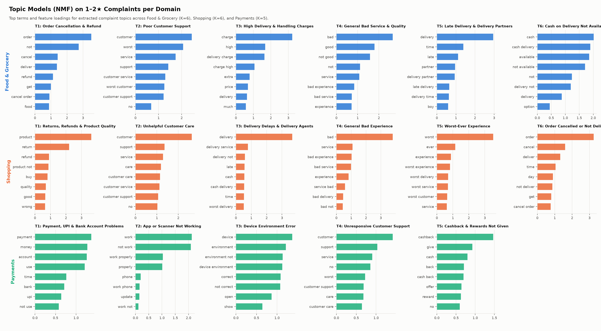
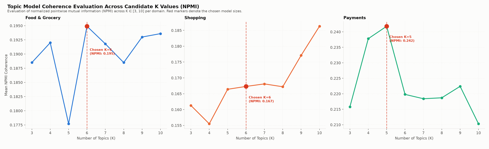
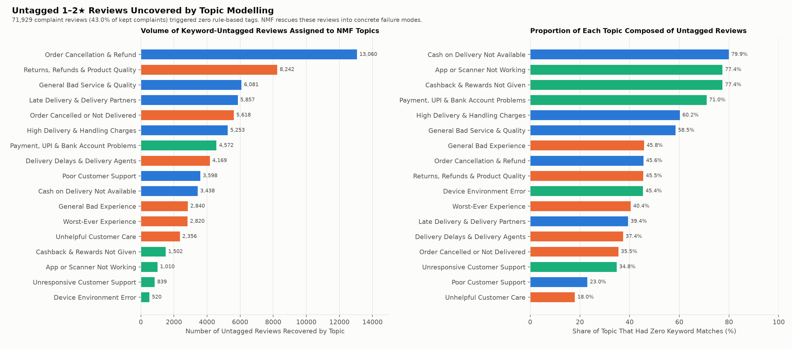
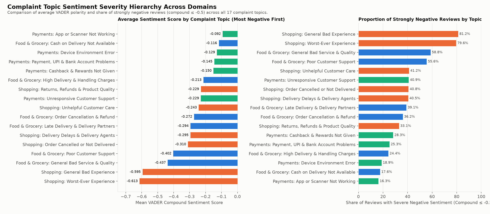
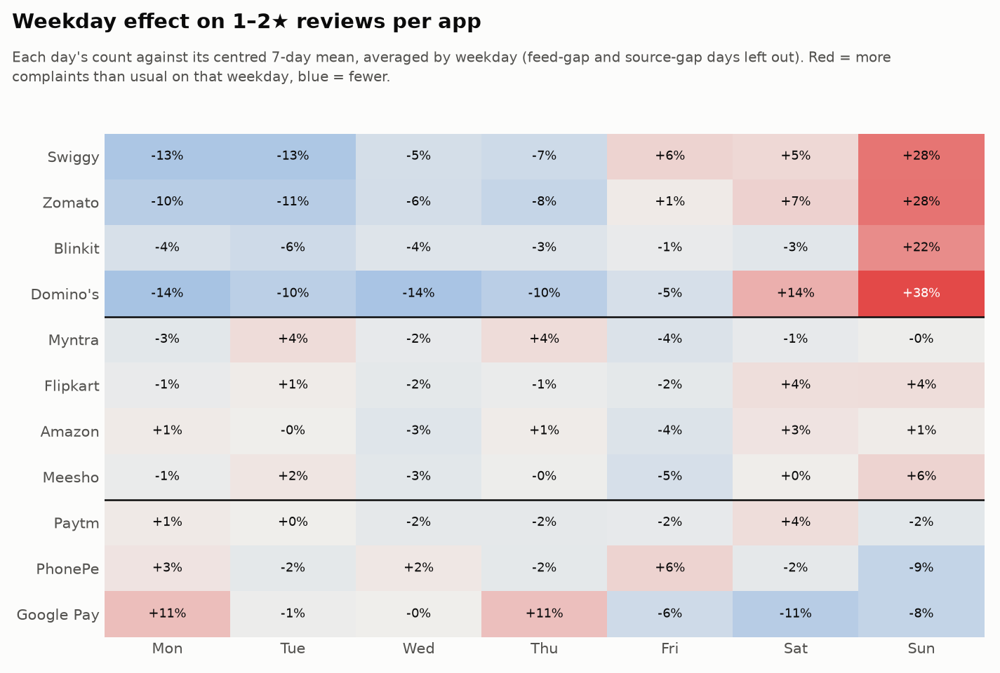
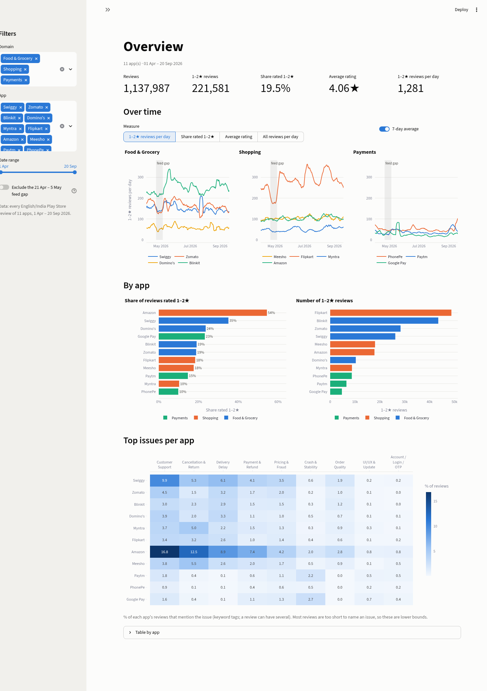
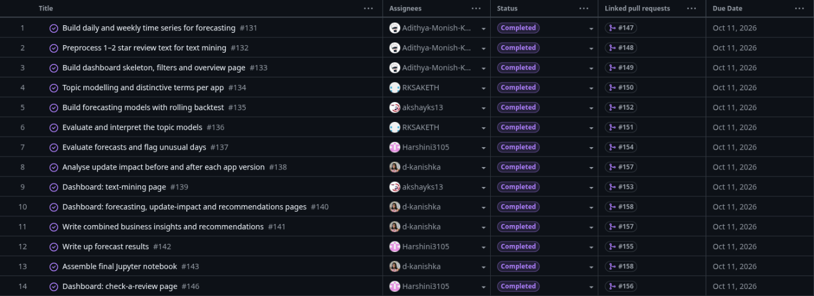

# Mobile App Update Impact and Failure Detection

**Final Project Report: Review 2**

Course: 23CSE452 Business Analytics

Review 2: Advanced Analytics (Unit 3): Text Mining and Time-Series Analysis

Team number: 10

| # | Name | Register number |
|---|---|---|
| 1 | Aditya Monish Kumar K | CB.SC.U4CSE23103 |
| 2 | Regella Krishna Saketh | CB.SC.U4CSE23649 |
| 3 | Akshay KS | CB.SC.U4CSE23104 |
| 4 | Harshini Vennela | CB.SC.U4CSE23455 |
| 5 | Kanishka D | CB.SC.U4CSE23155 |

| Link | |
|---|---|
| Live dashboard | https://team10-app-reviews.streamlit.app/ |
| Repository | https://github.com/Adithya-Monish-Kumar-K/ba-capstone-app-reviews |
| Project board | https://github.com/users/Adithya-Monish-Kumar-K/projects/4 |
| Final notebook | `notebooks/Review_2.ipynb` (executed; HTML copy `notebooks/Review_2.html`) |

---

## Summary

We collected every Play Store review of 11 Indian consumer apps from 1 April to 20 September 2026 (1,137,987 reviews after cleaning). Review 1 cleaned the data, tagged 9 issue types, scored sentiment and built a classifier that flags problem reviews. Review 2 applies two Unit 3 methods to the same data and combines everything into recommendations and a live dashboard.

- **Method 1, text mining.** NMF topic models on 167,357 complaint reviews find 17 complaint topics across the three domains. They agree with the keyword tags where they should, and they also cover the 43% of complaints (71,929) that match no keyword tag. Refund and cancellation problems lead Food & Grocery (35% of complaints), returns and defective products lead Shopping (25%), and failed transfers lead Payments (52%). The angriest topics are about loss and broken trust, such as scam allegations (mean VADER −0.61) and poor quality (−0.60). Technical faults are reported calmly (−0.09).
- **Method 2, time series.** ARIMA/SARIMA models forecast the daily number of 1–2★ reviews per app. On a rolling-origin backtest of 252 forecasts per app, ARIMA beats the seasonal-naive baseline for 10 of 11 apps (mean MASE 0.88 against 1.08). Its 80% and 95% intervals contain 81% and 93% of the days, and no app has autocorrelation left in its residuals. The forecast flags 83 unusual days. Of 205 testable app releases, 196 changed nothing measurable, 5 made things better and 4 made things worse. Only one, Paytm 10.84.5, is confirmed at the app level: Paytm's 1–2★ reviews per day went from 34 to 66.
- **Combined insights.** Six warning signs, drawn from every stage, give each app a priority. Swiggy, Flipkart, Amazon and Paytm are High priority. The signs also produce 65 recommendations, each backed by a number.
- **Dashboard.** One Streamlit app with six pages, deployed publicly. It covers the overview, text mining, forecasting, update impact, recommendations and checking a single review.

---

## 1. Problem, Questions and Methods

### 1.1 Problem

Apps like Swiggy, Zomato, Blinkit, Flipkart, Amazon, Paytm and PhonePe get hundreds of Play Store reviews a day, and the busiest get more than a thousand. Many reviews report real problems: a failed payment, a late delivery, a refund that never came, an app that misbehaves after an update. A product or support team cannot read them all, so problems are noticed late.

Review 1 answered "which reviews are problems?" with a classifier: Random Forest PR-AUC 0.87 against a base rate of 0.19. Review 2 asks the questions a manager needs answered next:

1. **What exactly are users complaining about, in their own words, and how angry are they?** Keyword tags miss reviews that are worded differently.
2. **How many complaints will each app get in the coming weeks, which days are unusual, and did a new app version make things worse?**
3. **Which app needs attention first, and what should it do?**

### 1.2 Methods chosen

The rubric asks for two of the three Unit 3 methods. We chose the two that fit review data best:

| Method | Why it fits | Answers |
|---|---|---|
| **Text mining** | The reviews are unstructured text; topic models find themes without a fixed keyword list, and sentiment measures how strongly users feel | Question 1 |
| **Time-series analysis** | The reviews are dated, so complaints form a daily series per app, and app versions give dated release events | Question 2 |

Association rule mining was not chosen. Only 3.4% of reviews carry two or more of the 9 issue tags (median review length is 2 words), so there are few co-occurring "items" to mine. Review 1's EDA had already measured how the tags co-occur (lift, EDA chart 7), so rules would repeat that rather than answer a new question.

### 1.3 How this addresses the research gap

Review 1 (§1.3 of `REPORT.md`) found four gaps in published app-review mining: reviews are studied as one fixed set; labels are generic; tasks are done alone; and collection bias is rarely checked. Review 2 addresses each of them:

- It **follows complaints over time**: daily series, forecasts and before/after tests around 224 releases.
- It finds **app-specific themes** from the text itself: 17 topics, plus the words that set each app apart.
- It **combines** text mining, forecasting, update impact and the classifier into one priority table and one dashboard.
- It carries the **feed gap** found in Review 1 into the models as an input instead of reading it as a real change.

---

## 2. Data

The data is the Review 1 dataset, collected by us from the Google Play Store (see `DATA_SOURCES.md`). It holds 1,137,987 English reviews from India for 11 apps in three domains, covering 1 April to 20 September 2026 (173 days):

| Domain | Apps |
|---|---|
| Food & Grocery | Swiggy, Zomato, Blinkit, Domino's |
| Shopping | Myntra, Flipkart, Amazon, Meesho |
| Payments | Paytm, PhonePe, Google Pay |

Review 2 uses the following outputs of Review 1:

- the star rating, used to define complaints (1–2★) and praise (4–5★);
- the review text and date;
- the app version on the reviewer's phone;
- the 9 keyword issue tags;
- the VADER sentiment scores;
- the saved classifiers.

There are two known data-quality points:

- **Feed gap.** From 21 April to 5 May, the Play Store feed is missing most positive reviews for Swiggy, Blinkit, Domino's, Flipkart and Amazon.
- **Zomato outage.** Zomato has no reviews from 23 July 22:00 to 25 July 12:30.

---

## 3. Method 1: Text Mining

Code: `scripts/16_text_preprocessing.py`, `17_topic_modelling.py`, `18_topic_evaluation.py`, `20_topic_examples.py`. The full write-up is `TEXT_MINING.md`.

### 3.1 Data preparation

**Two corpora.** A review is kept if it has at least 3 content words after cleaning, because one-word reviews ("worst", "good") cannot carry a topic.

| Corpus | Reviews | Kept | Median kept length |
|---|---:|---:|---:|
| Complaints (1–2★) | 221,581 | 167,357 (75.5%) | 11 words |
| Praise (4–5★), as a contrast | 871,380 | 166,929 (19.2%) | 4 words |

**Cleaning steps:**

1. Lowercase the text and remove links, e-mail addresses, emojis and digits.
2. Remove two-word brand names as phrases ("google pay", "phone pe"), so that "pay" and "google" stay usable on their own.
3. Expand contractions, with or without the apostrophe ("didnt" → "did not").
4. Drop stop words but **keep negations**, so that "not delivered" keeps its meaning.
5. Map Hinglish negations ("nahi", "nhi") to "not", and drop Hinglish filler words.
6. Drop app names, so that topics describe problems rather than apps.
7. Lemmatise with WordNet ("refunded" → "refund").

For example, "PLEASE STOP CHEATING US BY CHARGING DELIVERY CHARGES FOR ORDERS ABOVE 100…" becomes `stop cheat charge delivery charge order people number fraud`.

**Document-term matrices.** There is one matrix per corpus and domain, holding words and two-word phrases that appear in at least 10 reviews and at most half of them:

| Matrix | Reviews | Terms |
|---|---:|---:|
| Complaints · Food & Grocery | 82,603 | 17,448 |
| Complaints · Shopping | 71,413 | 18,665 |
| Complaints · Payments | 13,341 | 2,982 |
| Praise · Food & Grocery | 74,647 | 6,875 |
| Praise · Shopping | 75,672 | 7,097 |
| Praise · Payments | 16,610 | 1,763 |

### 3.2 Implementation: NMF topic models

- **Model.** The counts are converted to TF-IDF weights. Non-negative Matrix Factorisation splits each domain's matrix into document-topic weights and topic-term weights (V ≈ W × H) [6].
- **Why NMF and not LDA.** On very short, informal reviews, LDA tends to mix themes. NMF with the `nndsvda` start is deterministic and fits 167,357 reviews in seconds.
- **One model per domain.** The models use K = 6 for Food & Grocery, 6 for Shopping and 5 for Payments (chosen in §3.3).
- **Topic and sentiment for every review.** Every review gets its dominant topic. Its VADER compound score then gives each topic a mean sentiment and a share of strongly negative reviews (compound ≤ −0.5).
- **Praise contrast.** A second NMF model (K = 4 per domain) on the 4–5★ reviews shows what satisfied users mention.
- **Saved pipelines.** Each fitted model is saved with its vectoriser in `models/textmining/`, so the dashboard can give a new review its topic.

The 17 complaint topics (`data/textmining/topic_sentiment.csv`):

| Domain | Topic | Reviews | Share of domain | Mean VADER | Strongly negative |
|---|---|---:|---:|---:|---:|
| Food & Grocery | Order Cancellation & Refund | 28,656 | 35% | −0.27 | 36% |
| | Customer Support & Bot Loop | 15,640 | 19% | −0.40 | 56% |
| | Delivery Delays & Rider Tracking | 14,856 | 18% | −0.29 | 39% |
| | Poor Food Quality & Stale Items | 10,412 | 13% | −0.44 | 59% |
| | Excessive Delivery & Handling Charges | 8,730 | 11% | −0.21 | 24% |
| | COD & Payment Option Failures | 4,309 | 5% | −0.12 | 18% |
| Shopping | Return Rejection & Defective Products | 18,156 | 25% | −0.23 | 33% |
| | Order Cancellation & Rescheduling | 15,824 | 22% | −0.31 | 41% |
| | Customer Service & Escalation Failure | 13,121 | 18% | −0.24 | 41% |
| | Courier Delays & Delivery Agent Issues | 11,147 | 16% | −0.29 | 41% |
| | Extreme Dissatisfaction & Scam Allegations | 6,973 | 10% | −0.61 | 80% |
| | Poor Shopping Experience & Fabric Quality | 6,192 | 9% | −0.60 | 81% |
| Payments | Failed Transfers & Debited Amounts | 6,909 | 52% | −0.15 | 27% |
| | Customer Support Unresponsiveness | 2,404 | 18% | −0.23 | 40% |
| | Device Environment & Security Scan Errors | 1,382 | 10% | −0.11 | 18% |
| | Account Blocking & AutoPay Issues | 1,379 | 10% | −0.13 | 21% |
| | App Crashes & Update Regressions | 1,267 | 9% | −0.09 | 16% |



### 3.3 Evaluation

**Number of topics (coherence).** NPMI coherence [7] was computed for K = 3 to 10 in each domain (`coherence_scores.csv`):

- **Food & Grocery.** Coherence has a clear peak at K = 6 (0.195), which is the value chosen.
- **Shopping and Payments.** The curves are almost flat, from 0.155 to 0.186 and from 0.181 to 0.212. The highest values sit at the edges of the range (K = 10 for Shopping, K = 3 for Payments). At K = 3 the Payments topics merge different failures into one. At larger K the Shopping topics split delivery and support into near-duplicates. We therefore took the K at which every topic is distinct and can be named: 6 for Shopping and 5 for Payments.

Coherence is therefore a guide here rather than the only criterion.



**Agreement with the 9 keyword tags.** We cross-tabulated each topic with the keyword tags from Review 1 (`topic_keyword_overlap.csv`). Topics and tags agree where they should:

| Topic | Matching keyword tag | Share of the topic's reviews with that tag |
|---|---|---:|
| Customer Support & Bot Loop (food) | Customer Support | 71% |
| Customer Service & Escalation Failure (shopping) | Customer Support | 76% |
| Delivery Delays & Rider Tracking | Delivery Delay | 51% |
| Device Environment & Security Scan Errors | Crash & Stability | 46% |
| Return Rejection; Order Cancellation & Rescheduling | Cancellation & Return | 31–39% |

The topics also split themes that the keyword rules keep together. For example, food quality is separated from delivery speed, and delivery charges are separated from other pricing complaints.

**What the keyword rules miss.** 71,929 of the 167,357 kept complaints (43.0%) match none of the 9 keyword tags. The topic models give every one of them a theme:

| Topic | Untagged reviews | Share of the topic that is untagged |
|---|---:|---:|
| Order Cancellation & Refund | 13,073 | 46% |
| Return Rejection & Defective Products | 8,275 | 46% |
| Poor Food Quality & Stale Items | 6,089 | 58% |
| Delivery Delays & Rider Tracking | 5,854 | 39% |
| Order Cancellation & Rescheduling | 5,625 | 36% |

The untagged share is highest for COD & Payment Option Failures (80%) and Failed Transfers & Debited Amounts (72%). These complaints are often written in Hinglish or informal wording ("paisa fas gaya"), which a keyword list does not cover.



### 3.4 Interpretation

**Sentiment by topic.**

- **Loss and broken trust produce the angriest reviews.** The two most negative topics are both in Shopping: scam allegations (−0.61, 80% strongly negative) and poor product quality (−0.60, 81%). In food apps, stale or wrong food (−0.44) angers users far more than late food (−0.29).
- **Technical faults are reported calmly.** In Payments, app crashes (−0.09) and device-environment errors (−0.11) are described factually ("app closes after update"). A mild VADER score is therefore not a sign of a mild problem.
- **In Payments, the anger is aimed at support.** Unanswered support (−0.23) draws more anger than the failed transfer itself (−0.15).



**How apps differ (distinctive words).** Standardised log-odds with an informative Dirichlet prior [8] compare each app with the other apps of its domain:

| App | Most distinctive complaint words | Reading |
|---|---|---|
| Swiggy | cancellation, cancellation fee, hour | Cancellation fees and long delays |
| Zomato | restaurant, support, gold, platform fee | Zomato Gold changes and platform fees |
| Blinkit | product, return, item, damage | Damaged or missing grocery items |
| Domino's | pizza, store, outlet, cheese | Store-level order problems |
| Myntra | exchange, tag, size | Size exchanges, and returns refused over tags |
| Flipkart | minute, fee, delay, reschedule | Flipkart Minutes delays, rescheduled deliveries, fees |
| Amazon | prime, membership, device, refund | Prime membership and refund disputes |
| Meesho | account, verification, block | Account verification and blocking |
| Paytm | device, error, correct | "Device environment not correct" security errors |
| PhonePe | charge, wallet, fee | Fees on recharges and payments |
| Google Pay | reward, pocket, bug | Rewards and app bugs |

**Praise as a contrast.** Satisfied users mention fast delivery (food), product quality and price (shopping), and easy UPI payments (payments).

**Topic share over time.** The topic mix is stable from April to September:

- Order Cancellation & Refund stays at 34–36% of food complaints.
- Customer support rises slightly in Food & Grocery (18% to 20%) and in Payments (18% to 20%).
- Failed transfers fall from 54% to 49% of payment complaints.

---

## 4. Method 2: Time-Series Analysis

Code: `scripts/15_time_series_data.py`, `19_forecasting.py`, `20_forecast_evaluation.py`, `21_update_impact.py`. The full write-up is `TIME_SERIES.md`.

### 4.1 Data preparation and patterns

**The series.** The modelled series is the daily count of 1–2★ reviews per app: 11 series of 173 days. We use counts rather than shares because the feed gap removed mostly positive reviews, which distorts shares far more than counts.

**Data-quality flags:**

- **Feed gap.** The feed-gap days (21 April – 5 May, five apps, 75 app-days) become a 0/1 input to the model.
- **Zomato outage.** Zomato's one fully missing day (24 July) is filled with the mean of the same weekday one and two weeks either side. The two partial days keep their real counts.

**Release events.** The first day an app version appears in the reviews marks its rollout. Of 2,507 versions, 224 count as new releases. A version counts if it:

- has at least 30 reviews;
- first appears after 1 April; and
- is numbered higher than every earlier version, which removes old builds that some users still run.

**Patterns.**

- **Trend (STL decomposition [9]).** Paytm rises the most (+60%, first four weeks against the last four), followed by Myntra (+22%), Amazon (+14%) and Blinkit (+13%). Google Pay, Domino's, Swiggy and Zomato fall.
- **Weekly pattern.** Food apps get 22–38% more complaints on Sundays: Domino's +38%, Swiggy +28%, Zomato +28% and Blinkit +22%. Shopping apps have no weekday pattern.
- **Stationarity.** The ADF test rejects a unit root for 9 of 11 apps in level. Only Zomato and Blinkit need differencing (d = 1).
- **Seasonal differencing.** STL seasonal strength is below 0.64 everywhere, so no app needs seasonal differencing (D = 0).



### 4.2 Implementation: ARIMA forecasting with a rolling-origin backtest

**Models.** Three models are fitted at every step:

| Model | Description |
|---|---|
| **ARIMA / SARIMA** (main) [10] | Seasonal terms at lag 7 for the four food apps only. The feed-gap flag is an extra input for the five affected apps (SARIMAX). Gives 80% and 95% prediction intervals. |
| Seasonal naive (baseline) | The count on the same weekday last week. |
| Holt-Winters (comparison) | Damped additive trend with an additive weekly season. |

**Choosing the orders:**

1. d comes from the ADF test, and D = 0 for every app.
2. The ACF and PACF propose p and q up to 3, and a seasonal AR or MA term at lag 7.
3. The lowest AICc wins. If several orders are within 2 points of the lowest, the one with the fewest terms is taken. In total, 378 candidate fits were tried.
4. There is no look-ahead: in the backtest, the orders are chosen on the first 84 days only.

| App | Final order (p,d,q)(P,D,Q)₇ | Feed-gap input |
|---|---|---|
| Swiggy | (0,0,1)(1,0,1) | yes |
| Zomato | (2,1,1)(1,0,1) | |
| Blinkit | (1,1,1)(1,0,1) | yes |
| Domino's | (0,0,1)(1,0,1) | yes |
| Myntra | (3,0,2) | |
| Flipkart | (1,0,1) | yes |
| Amazon | (1,0,1) | yes |
| Meesho | (0,0,2) | |
| Paytm | (2,0,2) | |
| PhonePe | (1,0,0) | |
| Google Pay | (1,0,0) | |

Only the food apps need seasonal terms, which matches their Sunday peak. Forcing seasonal terms onto the other apps changed their backtest error by less than 1.5 reviews a day.

**Rolling-origin backtest.** Each model is trained on the first 84 days and forecasts the next 28. The origin then moves one week and every model is refitted. This gives 9 origins (23 June to 18 August) and 252 forecasts per app and model.


### 4.3 Evaluation

**Accuracy.** MAE and RMSE are in reviews per day. MASE is scaled by the seasonal-naive error on the training data [11]. Values are means over the 11 apps:

| Model | MAE | RMSE | MASE | Lower MAE than seasonal naive |
|---|---:|---:|---:|---|
| **ARIMA** | **17.95** | **24.95** | **0.88** | **10 of 11 apps** |
| Holt-Winters | 19.14 | 26.66 | 0.93 | – |
| Seasonal naive | 21.99 | 31.07 | 1.08 | baseline |

ARIMA's MAE per app, against the seasonal-naive baseline:

| App | ARIMA | Seasonal naive | Holt-Winters |
|---|---:|---:|---:|
| Swiggy | 27.6 | 34.6 | 27.4 |
| Zomato | 22.8 | 23.9 | 21.5 |
| Blinkit | 28.8 | 33.8 | 26.8 |
| Domino's | 15.8 | 18.3 | 14.4 |
| Myntra | 10.5 | 13.9 | 12.8 |
| Flipkart | 38.1 | 56.0 | 54.7 |
| Amazon | 12.9 | 16.9 | 14.5 |
| Meesho | 13.6 | 19.3 | 15.1 |
| Paytm | 8.6 | 8.8 | 7.9 |
| PhonePe | 7.9 | 10.0 | 8.0 |
| Google Pay | 10.9 | 6.2 | 7.5 |

- **Where ARIMA gains most.** The largest gains are for apps with a trend or a slowly moving level: Flipkart −32%, Meesho −29%, Myntra −25% and Amazon −24% against the baseline.
- **Google Pay is the exception.** Its level is low and noisy and it shifted after training, so "same day last week" adapts faster.
- **Holt-Winters.** It has a lower MAE than ARIMA for six apps (the four food apps, Paytm and Google Pay) but a higher average. ARIMA stays the main model because it is the only one with prediction intervals and with the feed gap as an input.

**Prediction intervals.** Across 2,772 backtest forecasts, 81.4% of days fell inside the 80% interval and 92.7% inside the 95% interval. The 80% interval is well calibrated and the 95% interval is slightly narrow. Because rolling windows overlap, this is a descriptive check rather than an independent test.

**Residuals.** The Ljung–Box test at lag 14 [12] gives p > 0.05 for all 11 final models, so no autocorrelation is left at that lag. This does not prove that the residuals are random.

**Unusual-day alerts.** A forecast is flagged when the actual count falls outside its 95% interval:

- **Volume.** 201 forecasts were flagged. Because origins overlap, they cover 83 distinct app-days (67 above the interval, 16 below).
- **Apps with the most alerts.** Flipkart has the most (18), followed by Myntra (13), Amazon (11), Meesho (11), Swiggy (10) and Paytm (10).
- **Largest alerts.** Swiggy on 24 July (469 against 157 expected, upper limit 202), Flipkart on 4 July (451 against 264) and Blinkit on 28 August (387 against 247).
- **What an alert means.** An alert marks an unexpected count. It does not prove a cause.

### 4.4 Interpretation: which apps can be predicted

| Group | Apps | Evidence |
|---|---|---|
| Predictable | Zomato, Blinkit, Domino's | A steady weekly rhythm. The 95% interval holds 99% of days for Zomato, 97% for Blinkit and 95% for Domino's. Swiggy shares the rhythm but has short spikes (24 July), so its 95% interval holds 90%. |
| Hard to predict | Flipkart, Amazon, Meesho, Myntra | Level shifts. The 80% interval holds only 64–71% of days, and these apps have the most alerts. |
| Use with care | Google Pay, Paytm | Google Pay is low and noisy (the baseline wins). Paytm jumped to about 80 a day in September, so its week-1 forecast (−61%) is unreliable. |

**Forecast for 21–27 September** (1–2★ reviews in the week after the data):

| App | Forecast | 80% interval | vs last 4 weeks |
|---|---:|---|---:|
| Flipkart | 1,830 | 1,596 – 2,056 | −7% |
| Blinkit | 1,711 | 1,488 – 1,929 | −8% |
| Swiggy | 1,037 | 889 – 1,180 | +7% |
| Zomato | 977 | 811 – 1,151 | −7% |
| Meesho | 737 | 676 – 801 | +4% |
| Amazon | 714 | 642 – 786 | −6% |
| Domino's | 413 | 327 – 495 | +7% |
| Myntra | 371 | 318 – 424 | −10% |
| PhonePe | 348 | 270 – 431 | −10% |
| Google Pay | 192 | 105 – 310 | +3% |
| Paytm | 136 | 75 – 205 | −61% (unreliable) |


### 4.5 Update impact: did a new version make things worse?

**Method.** Each of the 224 releases is tested over 7-day windows. The release day is the day the version got its 10th review.

| View | Comparison | Test |
|---|---|---|
| A. Before vs after (app level) | The app's 1–2★ reviews per day in the week before against the week from the release | Welch t-test |
| B. New vs older version (main test) | Over the same 7 days, the 1–2★ share of users on the new version against users still on older versions | Two-proportion z-test |

View B is the main test because both groups cover the same days, so sales and outages affect both equally.

**Usual gap.** Users on the newest version are not a random sample. On Amazon and Flipkart they are always about 6 points more negative than users on older versions. Each release is therefore compared with its own app's usual gap (the median over the app's other releases).

**Verdicts:**

- **Worse:** at least 5 points beyond the usual gap, with q < 0.05 after Benjamini–Hochberg correction over all releases [13].
- **Confirmed at app level:** the app's 1–2★ reviews per day also rose significantly in View A.

**Results.**

| Verdict | Releases |
|---|---:|
| Worse, confirmed at app level | 1 |
| Worse, new version only | 3 |
| No clear change | 196 |
| Better | 5 |
| Not testable (window outside the data or too few reviews) | 19 |
| **Total** | **224** |

| App | Version | Release | 1–2★ new vs older | Beyond usual gap | 1–2★ per day before → after | Issue that rose most |
|---|---|---|---|---:|---|---|
| Swiggy | 4.107.1 | 19 Apr | 60% vs 42% | +21.2 pts | 162 → 150 | Customer Support +8.9 pts |
| Swiggy | 4.107.2 | 23 Apr | 88% vs 83% | +8.5 pts | 163 → 137 | – |
| Flipkart | 9.3 | 16 Apr | 30% vs 16% | +7.6 pts | 263 → 234 | Customer Support +4.2 pts |
| **Paytm** | **10.84.5** | **3 Sep** | **23% vs 13%** | **+8.1 pts** | **34 → 66** | spread across issues |


**Interpretation.**

- **Paytm 10.84.5 is the clearest bad release.** Its users rated it lower than users on older versions (3.95 against 4.41), and the app's 1–2★ reviews per day nearly doubled. The forecast stage independently raised 6 alerts in the week after it. The release explains Paytm's September jump and its unreliable forecast.
- **The other three releases need care.** Their 7-day windows overlap the late-April feed gap, so their shares are inflated. The comparison is still fair, because both groups cover the same days.
- **The release that followed recovered.** Swiggy 4.108.0, which replaced the two worse Swiggy versions, is one of the 5 better releases.
- **Most apps had no bad release.** No release made things worse for Zomato, Blinkit, Domino's, Myntra, Amazon, Meesho, PhonePe or Google Pay.
- **The result is robust.** With the release day set to the first review on the version, the same 4 releases are flagged.


---

## 5. Combined Business Insights and Recommendations

Code: `scripts/22_combined_insights.py`. Tables are in `data/combined/` and the full write-up is `COMBINED_INSIGHTS.md`.

### 5.1 Priority rule

Each app scores one point per warning sign. A score of 3 or more is High priority, 2 is Medium and 0–1 is Low.

| Warning sign | Rule | Source stage |
|---|---|---|
| Many 1–2★ per day | Above the median of the 11 apps (103 a day) | Time-series data |
| High 1–2★ share | Above the all-app share of 18.9% (feed-gap days excluded) | Time-series data |
| Rising trend | Last 4 weeks at least 10% above the first 4 | Time-series patterns |
| Forecast above recent | A reliable week-1 forecast at least 5% above the last 4 weeks | Forecasting |
| Days above forecast | At least 5 days above the 95% interval | Forecast evaluation |
| Release made it worse | At least one worse release | Update impact |

A forecast counts as **reliable** only if ARIMA beat the baseline in the backtest and the week-1 change is within ±30%. This excludes Paytm and Google Pay. The rule is deliberately simple: every point can be traced to one number in one stage.

### 5.2 Priority table

| App | Domain | Priority | 1–2★ / day | 1–2★ share | Trend | Largest complaint topic | Days above interval | Worse releases |
|---|---|---|---:|---:|---:|---|---:|---|
| Swiggy | Food & Grocery | **High (4)** | 151 | 33.4% | −16% | Order Cancellation & Refund (37%) | 4 | 2 |
| Flipkart | Shopping | **High (3)** | 282 | 17.7% | +5% | Return Rejection & Defective Products (25%) | 18 | 1 |
| Amazon | Shopping | **High (3)** | 103 | 53.4% | +14% | Customer Service & Escalation Failure (24%) | 9 | 0 |
| Paytm | Payments | **High (3)** | 38 | 14.6% | +60% | Failed Transfers & Debited Amounts (44%) | 10 | 1 (confirmed) |
| Blinkit | Food & Grocery | Medium (2) | 251 | 18.4% | +13% | Order Cancellation & Refund (33%) | 3 | 0 |
| Meesho | Shopping | Medium (2) | 104 | 17.6% | +2% | Return Rejection & Defective Products (28%) | 9 | 0 |
| Domino's | Food & Grocery | Medium (2) | 60 | 22.6% | −18% | Order Cancellation & Refund (41%) | 4 | 0 |
| Myntra | Shopping | Medium (2) | 51 | 10.3% | +22% | Return Rejection & Defective Products (26%) | 9 | 0 |
| Zomato | Food & Grocery | Low (1) | 164 | 18.8% | −11% | Order Cancellation & Refund (33%) | 0 | 0 |
| Google Pay | Payments | Low (1) | 27 | 23.2% | −20% | Failed Transfers & Debited Amounts (59%) | 0 | 0 |
| PhonePe | Payments | Low (0) | 50 | 9.8% | +3% | Failed Transfers & Debited Amounts (54%) | 1 | 0 |


### 5.3 Recommendations per domain

| Domain | Fix first (most common complaint) | Most damaging (angriest complaint) | Focus |
|---|---|---|---|
| Food & Grocery | **Refund and cancellation flow**: 35% of the domain's complaints (28,656), the largest topic in every food app | **Food quality**: −0.44, 59% strongly negative; act fast on stale or wrong food | Swiggy (High). Blinkit has the most complaints, 251 a day |
| Shopping | **Return rejections and defective products**: 25% (18,156), the largest topic in Flipkart, Meesho and Myntra | **Scam allegations**: −0.61, 80% strongly negative; answer quickly and visibly | Flipkart and Amazon (High) |
| Payments | **Money debited but not received**: 52% (6,909) | **Unanswered support**: −0.23, angrier than the failure itself (−0.15) | Paytm (High). PhonePe has the most complaints, 50 a day, but only 9.8% of its reviews |

### 5.4 Recommendations for the High-priority apps

**Swiggy (4 signs)**

- Fix refunds and cancellations first: they are 37% of its complaints, with a sentiment of −0.33.
- Review version 4.107.1. Its users were 21 points more negative than Swiggy's usual gap, and support complaints rose 8.9 points.
- Plan support for about 1,037 1–2★ reviews in the week of 21–27 September (80% interval 889–1,180).

**Flipkart (3 signs)**

- Fix return rejections and defective products first: 25% of its complaints.
- Set a daily alert. Flipkart had 18 days above the forecast interval, the most of any app; the largest was 451 against 264 expected on 4 July.
- Review version 9.3, after which support and return complaints rose.

**Amazon (3 signs)**

- Fix escalations in customer service first: 24% of its complaints.
- Amazon has the highest 1–2★ share of all 11 apps (53%), and it is rising (+14%).
- Use the Review 1 classifier to triage reviews: it is most useful here, with 91% precision and 96% recall.

**Paytm (3 signs)**

- Investigate version 10.84.5 first. It is the only release confirmed at the app level, and it took 1–2★ reviews from 34 to 66 a day.
- Plan capacity on last week's level, not on the ARIMA forecast, which is unreliable after the September jump.
- Have a person check flagged reviews, because the classifier's precision is lowest here (66%).

The Medium- and Low-priority apps get the same four kinds of recommendation: fix first, most damaging, plan capacity and triage. In total there are 65 recommendations (`data/combined/recommendations.csv`), and all of them are shown on the dashboard.

---

## 6. Interactive Dashboard

The dashboard is a Streamlit app (`dashboard/`), deployed on Streamlit Community Cloud at **https://team10-app-reviews.streamlit.app/**. It redeploys from the `master` branch after every merge. It reads only small precomputed tables, so it opens in seconds.

Every page shares the same sidebar filters: domain, app, date range, and an option to exclude the feed gap.

| Page | What the user can do | Built by |
|---|---|---|
| Overview | Headline numbers, 1–2★ reviews per day by domain (four measures, 7-day smoothing), share and count of 1–2★ reviews by app, top keyword issues, table with CSV download | Aditya |
| Text mining | Topic explorer with top terms, sentiment and real example reviews (189 readable examples); keyword-tag overlap; topic × app heatmap; topic share over time; distinctive terms per app | Akshay |
| Forecasting | ARIMA forecast per app with 80% and 95% intervals, optional baseline comparison, unusual days above and below the interval, release markers (red = made things worse), weekly forecast table and backtest error | Kanishka |
| Update impact | Verdict for every release, new-vs-older gap against the app's usual gap, daily series with releases, before/after detail and issue mix of any release, CSV download | Kanishka |
| Recommendations | Priority counts, warning-sign grid, priority table and recommendations, filtered by domain and app, with downloads | Kanishka |
| Check a review | Paste any review: the Review 1 classifiers' problem probability with an adjustable threshold, the complaint topic from the saved NMF model, VADER scores and keyword tags | Harshini |



---

## 7. Limitations

- **Short window.** Only 173 days of data are available, so there is no yearly pattern and the backtest has only 9 origins.
- **Counts depend on things the models do not see.** Review counts follow app traffic and campaigns. The forecast answers "what if the next weeks look like the recent past".
- **A 1–2★ review is a judgement, not a confirmed defect.** It is the user's own judgement. The issue mix in the update-impact test uses keyword tags, which miss complaints worded differently.
- **Topic names are our reading of the top terms.** Some topics have general top terms; for example, "Poor Food Quality & Stale Items" leads with "bad", "not good" and "quality". The example reviews on the dashboard let a reader check each name.
- **VADER underrates calm technical complaints.** Sentiment shows how users feel, not how severe a fault is.
- **Users choose when to update.** Early updaters may differ from late ones, which is why each release is compared with its app's usual gap. Three of the four worse releases have windows that overlap the feed gap.
- **The priority score is simple.** It weights every sign equally and uses fixed thresholds. Each sign is shown separately, so the reason for a priority is always visible.

---

## 8. Project Tracking and Individual Contributions (Review 2)

**Board.** The GitHub Projects board (https://github.com/users/Adithya-Monish-Kumar-K/projects/4) uses the stages Backlog → To Do → In Progress → Review/Testing → Completed.

- **Tasks.** Review 2 has 14 tasks, each assigned to one member with a due date of 11 October. All 14 are Completed.
- **Pull requests.** Every task is linked to a merged pull request, and every issue is closed.
- **Order of work.** The work was done as a relay: each stage started on the merged work of the stage before.



| Member | Register number | Stage | Board tasks | Pull requests | Evidence |
|---|---|---|---|---|---|
| Aditya Monish Kumar K | CB.SC.U4CSE23103 | 1 and 6 | #131 daily and weekly series, release events and patterns; #132 text preprocessing; #133 dashboard skeleton, filters, overview page and deployment. Stage 6: slide deck, final report, contribution summary | #147, #148, #149 | `scripts/15_time_series_data.py`, `scripts/16_text_preprocessing.py`, `data/timeseries/`, `data/textmining/`, `dashboard/app.py`, `dashboard/common.py`, `dashboard/pages/overview.py`, `FINAL_REPORT.md` |
| Regella Krishna Saketh | CB.SC.U4CSE23649 | 2 | #134 topic modelling, distinctive terms and sentiment per topic; #136 coherence, keyword-tag comparison, untagged reviews and topic trends | #150, #151 | `scripts/17_topic_modelling.py`, `scripts/18_topic_evaluation.py`, `models/textmining/`, `TEXT_MINING.md` §2–3 |
| Akshay KS | CB.SC.U4CSE23104 | 3 | #135 ARIMA/SARIMAX forecasting with rolling backtest; #139 text-mining dashboard page | #152, #153 | `scripts/19_forecasting.py`, `scripts/20_topic_examples.py`, `dashboard/pages/text_mining.py`, `TIME_SERIES.md` §2.1–2.4, 2.6–2.8 |
| Harshini Vennela | CB.SC.U4CSE23455 | 4 | #137 forecast evaluation, residual checks and unusual-day alerts; #142 forecast write-up; #146 check-a-review page | #154, #155, #156 | `scripts/20_forecast_evaluation.py`, `dashboard/pages/check_review.py`, `TIME_SERIES.md` §2.5 |
| Kanishka D | CB.SC.U4CSE23155 | 5 | #138 update impact; #141 combined insights and recommendations; #140 forecasting, update-impact and recommendations pages; #143 final notebook | #157, #158 | `scripts/21_update_impact.py`, `scripts/22_combined_insights.py`, `dashboard/pages/forecasting.py`, `update_impact.py`, `recommendations.py`, `COMBINED_INSIGHTS.md`, `notebooks/Review_2.ipynb` |

The detailed contribution summary is `docs/Review_2_Contribution_Summary.md`.

---

## 9. Conclusion

- **Users complain mostly about service, not about the app software.** Refunds and cancellations, returns, failed transfers and support lead every domain. The most damaging complaints are about loss and broken trust.
- **Text mining finds what keyword rules miss.** The topic models agree with the keyword tags where both apply, and they give a theme to the 43% of complaints that no keyword matched.
- **Daily complaints can be forecast well enough to plan support.** ARIMA beats the baseline for 10 of 11 apps with honest intervals. Its alerts mark days that need a look. Shopping apps with level shifts, Google Pay and Paytm need more care.
- **Most app updates do not hurt.** Of 205 testable releases, 196 changed nothing measurable. Paytm 10.84.5 clearly made things worse, and the forecast caught it independently.
- **Fix first:** Swiggy, Flipkart, Amazon and Paytm. The live dashboard puts all of this, and a check for any single review, in front of a product or support team.

Together, Reviews 1 and 2 turn 1.1 million unstructured reviews into a monitoring tool. A team can see what is going wrong, whether it is getting worse, whether an update caused it, and what to fix first.

---

## 10. How to Reproduce (Review 2)

```bash
pip install -r requirements.txt
python -c "import nltk; nltk.download('vader_lexicon')"

python scripts/15_time_series_data.py      # daily/weekly series, release events, STL, ADF, ACF/PACF
python scripts/16_text_preprocessing.py    # complaint and praise corpora, document-term matrices
python scripts/17_topic_modelling.py       # NMF topics, distinctive terms, sentiment per topic
python scripts/18_topic_evaluation.py      # coherence, keyword-tag overlap, untagged reviews, trends
python scripts/20_topic_examples.py        # readable example reviews for the dashboard
python scripts/19_forecasting.py           # ARIMA/SARIMAX, baselines, rolling backtest, 4-week forecast
python scripts/20_forecast_evaluation.py   # MAE/RMSE/MASE, interval coverage, Ljung-Box, alerts
python scripts/21_update_impact.py         # before/after and new-vs-older tests per release
python scripts/22_combined_insights.py     # priority table and recommendations

streamlit run dashboard/app.py             # the dashboard
```

The Review 1 steps (scripts 01–14) are listed in `REPORT.md` §11.

---

## 11. References

[1] D. Pagano and W. Maalej, "User feedback in the AppStore: An empirical study," IEEE International Requirements Engineering Conference (RE), 2013.

[2] N. Chen, J. Lin, S. C. H. Hoi, X. Xiao and B. Zhang, "AR-Miner: Mining informative reviews for developers from mobile app marketplace," International Conference on Software Engineering (ICSE), 2014.

[3] E. Guzman and W. Maalej, "How do users like this feature? A fine grained sentiment analysis of app reviews," IEEE International Requirements Engineering Conference (RE), 2014.

[4] W. Maalej and H. Nabil, "Bug report, feature request, or simply praise? On automatically classifying app reviews," IEEE International Requirements Engineering Conference (RE), 2015.

[5] C. J. Hutto and E. Gilbert, "VADER: A parsimonious rule-based model for sentiment analysis of social media text," International AAAI Conference on Weblogs and Social Media (ICWSM), 2014.

[6] D. D. Lee and H. S. Seung, "Learning the parts of objects by non-negative matrix factorization," Nature, vol. 401, pp. 788–791, 1999.

[7] G. Bouma, "Normalized (pointwise) mutual information in collocation extraction," Proceedings of GSCL, 2009; M. Röder, A. Both and A. Hinneburg, "Exploring the space of topic coherence measures," ACM WSDM, 2015.

[8] B. L. Monroe, M. P. Colaresi and K. M. Quinn, "Fightin' words: Lexical feature selection and evaluation for identifying the content of political conflict," Political Analysis, vol. 16, no. 4, pp. 372–403, 2008.

[9] R. B. Cleveland, W. S. Cleveland, J. E. McRae and I. Terpenning, "STL: A seasonal-trend decomposition procedure based on loess," Journal of Official Statistics, vol. 6, no. 1, pp. 3–73, 1990.

[10] G. E. P. Box, G. M. Jenkins, G. C. Reinsel and G. M. Ljung, Time Series Analysis: Forecasting and Control, 5th ed., Wiley, 2015; R. J. Hyndman and G. Athanasopoulos, Forecasting: Principles and Practice, 3rd ed., OTexts, 2021.

[11] R. J. Hyndman and A. B. Koehler, "Another look at measures of forecast accuracy," International Journal of Forecasting, vol. 22, no. 4, pp. 679–688, 2006.

[12] G. M. Ljung and G. E. P. Box, "On a measure of lack of fit in time series models," Biometrika, vol. 65, no. 2, pp. 297–303, 1978.

[13] Y. Benjamini and Y. Hochberg, "Controlling the false discovery rate: A practical and powerful approach to multiple testing," Journal of the Royal Statistical Society, Series B, vol. 57, no. 1, pp. 289–300, 1995.
