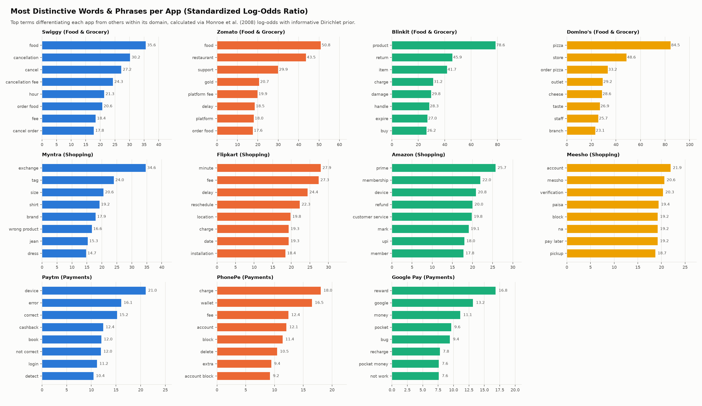
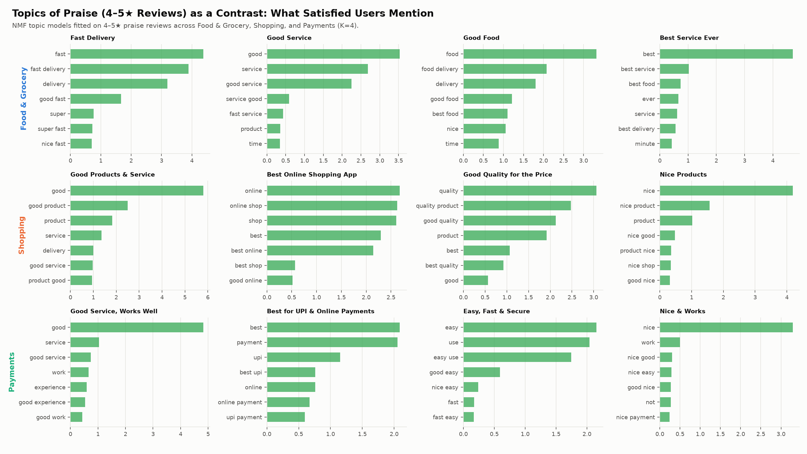
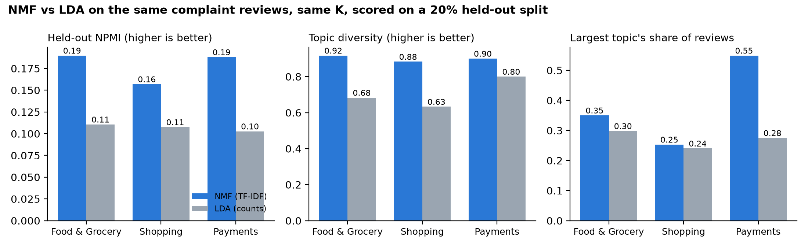
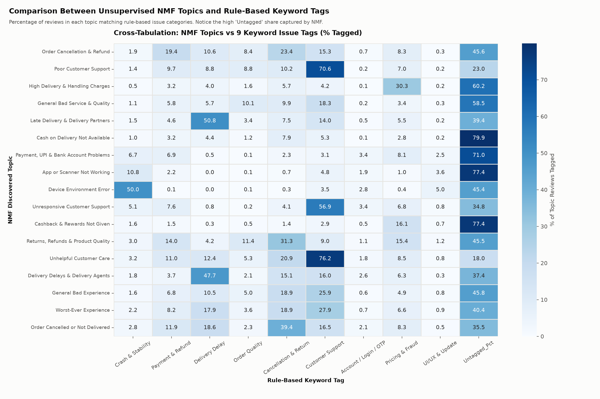
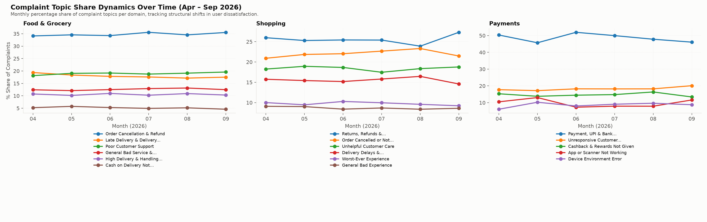
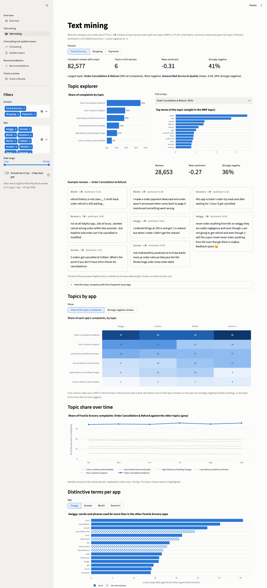

# Text Mining — Review 2, Method 1

**Capstone Project — Review 2 (Unit 3): Text Mining**
*Input: `data/tagged/<app>.csv.gz` (1,137,987 reviews, 11 apps, 1 Apr – 20 Sep 2026)*

The question: what are users actually complaining about in each app, how negative is each complaint theme, and what do satisfied users praise? This document grows stage by stage: data preparation (#132), topic modelling and sentiment (#134), and evaluation and interpretation (#136).

---

## 1. Data preparation (#132)

Code: `scripts/16_text_preprocessing.py` (about 3 minutes). Outputs in `data/textmining/`, chart in `data/charts/textmining/`, numbers in `data/textmining_summary.json`.

### 1.1 Two corpora

| Corpus | Reviews | Kept | Why |
|---|---:|---:|---|
| **Complaints** (1–2★) | 221,581 | 167,303 (75.5%) | The reviews whose themes we want to find |
| **Praise** (4–5★) | 871,380 | 166,635 (19.1%) | A contrast: what satisfied users mention |

A review is kept if it has **at least 3 content words after cleaning**; shorter reviews ("worst", "not open", "good") cannot carry a topic. Most praise is one or two words, which is why only 19% of it is kept. The median kept review has 11 content words for complaints and 4 for praise. 3★ reviews are left out of both corpora.

### 1.2 Cleaning steps

1. Lowercase; remove links and e-mail addresses.
2. Remove two-word brand names as phrases ("google pay", "phone pe", "phone pay", "amazon pay"), so the words "pay" and "google" stay usable on their own. "phone pay" is how many users spell PhonePe; before it was removed it formed a Payments topic of its own.
3. Expand contractions, with or without the apostrophe: "didn't" and "didnt" → "did not", "can't" → "can not".
4. Remove emojis, digits and punctuation; shorten letters repeated three or more times ("sooo" → "soo").
5. Drop stop words, but **keep negations** ("not", "no", "never", "nothing", "without"), so "not delivered" keeps its meaning. App names (Swiggy, Flipkart, …) are dropped so that topics describe problems, not apps.
6. Hinglish: "nahi", "nahin" and "nhi" become "not"; common function words ("hai", "mera", "mein", "bhi") are dropped. Content words (for example "paisa") are kept.
7. Lemmatise with WordNet (verb, then noun form): "delivered" → "deliver", "orders" → "order", "refunded" → "refund", "cancelled" → "cancel".

The same `clean()` function is used for new reviews: `scripts/17_topic_modelling.py` and the dashboard import it from this script, so there is one copy of the rules.

Example: *"PLEASE STOP CHEATING US BY CHARGING DELIVERY CHARGES FOR ORDERS ABOVE 100. YOU PEOPLE ARE NUMBER 1 FRAUDS."* → `stop cheat charge delivery charge order people number fraud`. More examples are in `data/textmining_summary.json` (`cleaning_examples`).

### 1.3 Document-term matrices

One matrix per corpus and domain, with counts of words and two-word phrases ("not deliver", "customer care"). A term is kept if it appears in at least 10 reviews and in at most half of them.

| Matrix | Reviews | Terms | Of which two-word phrases |
|---|---:|---:|---:|
| Complaints · Food & Grocery | 82,602 | 17,447 | 13,192 |
| Complaints · Shopping | 71,412 | 18,664 | 14,445 |
| Complaints · Payments | 13,289 | 2,974 | 1,537 |
| Praise · Food & Grocery | 74,647 | 6,876 | 4,454 |
| Praise · Shopping | 75,671 | 7,097 | 4,709 |
| Praise · Payments | 16,317 | 1,745 | 798 |

Files in `data/textmining/dtm/`: `<group>_<domain>.npz` (sparse counts), `<group>_<domain>_vocab.json` (column names) and `<group>_<domain>_rows.csv.gz` (the `review_id` and app of each row). For NMF, convert the counts with scikit-learn's `TfidfTransformer`; LDA uses the counts directly. `data/textmining/corpus.csv.gz` holds every kept review with its app, domain, rating, date, VADER sentiment, group and cleaned text.

### 1.4 First look (`tm_01_top_terms.png`)

Complaints name the service: in Food & Grocery the most frequent terms are "not" (48% of complaints), "order", "delivery", "customer" and "service"; in Shopping "order", "delivery", "customer" and "product"; in Payments "use", "payment", "work", "money" and "account", with "not work" among the top phrases. Praise is dominated by "good", "best" and "nice", plus "fast delivery" for food apps, "quality" and "price" for shopping, and "easy" and "upi" for payments. Raw frequency only shows the vocabulary; the topic models in #134 group these terms into themes.

### 1.5 Notes for topic modelling (#134)

- Fit one model per domain on the complaint matrices; the praise matrices are the contrast.
- "not" appears in more than half of Payments complaints, so it is dropped there by the 50% rule; phrases such as "not work" remain.
- Keep each matrix's row order: `_rows.csv.gz` links every row back to its review, app and sentiment in `corpus.csv.gz`.

---

## 2. Topic modelling and distinctive terms per app (#134)

Code: `scripts/17_topic_modelling.py` (under 20 seconds).
Outputs in `data/textmining/` (`topics.csv`, `topic_exemplars.csv`, `distinctive_terms.csv`, `topic_sentiment.csv`, `review_topics.csv.gz`), models in `models/textmining/`, charts in `data/charts/textmining/` (`tm_02`–`tm_05`), and summary in `data/topic_modelling_summary.json`.

### 2.1 Model and design choices

1. **Non-negative Matrix Factorization (NMF) on TF-IDF:**
   - Term counts from the document-term matrices are converted into TF-IDF weights using `TfidfTransformer()`.
   - NMF factors the matrix $V \approx W \times H$ into non-negative document-topic loadings $W$ and topic-term components $H$.
   - NMF with the `nndsvda` start (seed 42) is deterministic and fits 167,000 reviews in seconds. Section 3.2 compares it with LDA on held-out reviews.
2. **One model per domain:** **Food & Grocery** ($K=6$), **Shopping** ($K=6$) and **Payments** ($K=5$). A contrast model ($K=4$ per domain) is fitted on the 4–5★ praise reviews.
3. **Topic names** describe what each topic's top terms say. Three topics are general dissatisfaction rather than one fault ("bad experience", "worst ever"); their names say so, and the combined recommendations (`scripts/22_combined_insights.py`) never pick them as the complaint to fix.
4. **Each review gets its dominant topic** (largest NMF weight). The 105 reviews whose words all fall outside the vocabulary have zero weight on every topic; they are marked Unassigned (topic 0) and left out of topic shares and sentiment.

### 2.2 Complaint topics per domain (`tm_02_complaint_topics.png`)

| Domain | Topic | Theme | Reviews | Share of domain | Mean VADER | % Strongly Neg ($\le -0.5$) | Top terms |
|---|:---:|---|---:|---:|---:|---:|---|
| **Food & Grocery** | T1 | Order Cancellation & Refund | 28,653 | 34.7% | −0.272 | 36.2% | order, not, cancel, deliver, refund, cancel order, food |
| | T2 | Poor Customer Support | 15,641 | 18.9% | −0.402 | 55.6% | customer, worst, service, support, customer service, care |
| | T3 | High Delivery & Handling Charges | 8,724 | 10.6% | −0.214 | 24.4% | charge, high, delivery charge, extra, price, handle charge, fee |
| | T4 | General Bad Service & Quality | 10,394 | 12.6% | −0.437 | 58.8% | bad, good, not good, bad experience, bad service, quality |
| | T5 | Late Delivery & Delivery Partners | 14,861 | 18.0% | −0.295 | 39.1% | delivery, time, late, delivery partner, late delivery, delivery boy |
| | T6 | Cash on Delivery Not Available | 4,304 | 5.2% | −0.116 | 17.6% | cash, cash delivery, not available, option, cod |
| **Shopping** | T1 | Returns, Refunds & Product Quality | 18,123 | 25.4% | −0.229 | 33.1% | product, return, refund, product not, buy, quality, wrong |
| | T2 | Unhelpful Customer Care | 13,120 | 18.4% | −0.243 | 41.2% | customer, support, service, care, customer care, no customer |
| | T3 | Delivery Delays & Delivery Agents | 11,150 | 15.6% | −0.295 | 40.5% | delivery, delivery service, late, cash delivery, delivery agent |
| | T4 | General Bad Experience | 6,195 | 8.7% | −0.595 | 81.2% | bad, service, bad experience, bad service, bad delivery |
| | T5 | Worst-Ever Experience | 6,976 | 9.8% | −0.613 | 79.6% | worst, ever, worst experience, worst service, worst ever |
| | T6 | Order Cancelled or Not Delivered | 15,812 | 22.2% | −0.310 | 40.8% | order, cancel, deliver, day, not deliver, cancel order, delay |
| **Payments** | T1 | Payment, UPI & Bank Account Problems | 6,443 | 48.6% | −0.145 | 25.3% | payment, money, account, use, bank, upi, not use |
| | T2 | App or Scanner Not Working | 1,305 | 9.9% | −0.093 | 16.3% | work, not work, work properly, phone, update, open, scanner |
| | T3 | Device Environment Error | 1,146 | 8.7% | −0.129 | 18.9% | device, environment, device environment, not correct, error |
| | T4 | Unresponsive Customer Support | 2,410 | 18.2% | −0.229 | 40.9% | customer, support, service, no, customer support, care |
| | T5 | Cashback & Rewards Not Given | 1,941 | 14.7% | −0.150 | 28.3% | cashback, give, cash back, offer, reward, not give, fake |

Shares are of each domain's 1–2★ reviews with a topic (82,577, 71,376 and 13,245). Removing "phone pay" changed only Payments: the brand no longer forms a topic, customer support is its own topic, and **cashback and rewards that were promised but not given** separate from the general payment problems.


### 2.3 Distinctive words and phrases per app (`tm_03_distinctive_terms.png`)

To find what sets one app's complaints apart from the other apps of its domain, we computed standardized log-odds ratios with an informative Dirichlet background prior (Monroe, Colaresi and Quinn, 2008).

$$\hat{\delta}_w^{(i-j)} = \log \frac{y_w^{(i)} + \alpha_w}{n^{(i)} + \alpha_0 - (y_w^{(i)} + \alpha_w)} - \log \frac{y_w^{(j)} + \alpha_w}{n^{(j)} + \alpha_0 - (y_w^{(j)} + \alpha_w)}, \quad z_w = \frac{\hat{\delta}_w^{(i-j)}}{\sqrt{\frac{1}{y_w^{(i)} + \alpha_w} + \frac{1}{y_w^{(j)} + \alpha_w}}}$$

| Domain | App | Most distinctive words and phrases ($z$-score) | Reading |
|---|---|---|---|
| **Food & Grocery** | **Swiggy** | `food` (+35.6), `cancellation` (+30.2), `cancel` (+27.2), `cancellation fee` (+24.3), `hour` (+21.3) | Cancellation fees and long waits. |
| | **Zomato** | `food` (+50.8), `restaurant` (+43.5), `support` (+29.9), `gold` (+20.7), `platform fee` (+19.9) | Restaurants, Zomato Gold and the platform fee. |
| | **Blinkit** | `product` (+78.6), `return` (+45.9), `item` (+41.7), `charge` (+31.2), `damage` (+29.8) | Grocery items: returns, charges and damaged products. |
| | **Domino's** | `pizza` (+84.5), `store` (+48.6), `order pizza` (+33.2), `outlet` (+29.2), `cheese` (+28.6) | The pizza and the store or outlet. |
| **Shopping** | **Myntra** | `exchange` (+34.6), `tag` (+24.0), `size` (+20.6), `shirt` (+19.2), `brand` (+17.9) | Fashion: exchanges, sizes and brand tags. |
| | **Flipkart** | `minute` (+27.9), `fee` (+27.3), `delay` (+24.4), `reschedule` (+22.3), `location` (+19.8) | Flipkart Minutes, fees, delays and rescheduled deliveries. |
| | **Amazon** | `prime` (+25.7), `membership` (+22.0), `device` (+20.8), `refund` (+20.0), `customer service` (+19.8) | Prime membership, devices and refunds. |
| | **Meesho** | `account` (+21.9), `messho` (+20.6), `verification` (+20.3), `paisa` (+19.4), `block` (+19.2) | Account verification and blocked accounts. |
| **Payments** | **Paytm** | `device` (+21.0), `error` (+16.1), `correct` (+15.2), `cashback` (+12.4), `book` (+12.0) | The "device environment not correct" error, and cashback. |
| | **PhonePe** | `charge` (+18.0), `wallet` (+16.5), `fee` (+12.4), `account` (+12.1), `block` (+11.4) | Charges and fees, the wallet and blocked accounts. |
| | **Google Pay** | `reward` (+16.8), `google` (+13.2), `money` (+11.1), `pocket` (+9.6), `bug` (+9.4) | Rewards and the Pocket Money feature. |



### 2.4 Sentiment by topic (`tm_05_topic_sentiment.png`)

Mean VADER sentiment and the share of strongly negative reviews ($\text{compound} \le -0.5$) per topic:

1. **The most negative topics are the general ones.** Shopping's `Worst-Ever Experience` (−0.613, 79.6% strongly negative) and `General Bad Experience` (−0.595, 81.2%), and Food's `General Bad Service & Quality` (−0.437, 58.8%), are built from words such as "worst" and "bad", which VADER scores as very negative. They show how angry users are, not what to fix.
2. **Among specific faults, support angers users most.** `Poor Customer Support` in food apps (−0.402, 55.6% strongly negative) and `Unresponsive Customer Support` in payment apps (−0.229, 40.9%) are the most negative specific topics of their domains; in Shopping it is `Order Cancelled or Not Delivered` (−0.310, 40.8%).
3. **Technical faults are described calmly.** `App or Scanner Not Working` (−0.093, 16.3%) and `Device Environment Error` (−0.129, 18.9%) are reported factually ("app not working after update"), so tone is not severity.


### 2.5 Topics of praise as a contrast (`tm_04_praise_topics.png`)

NMF ($K=4$) on 4–5★ reviews shows the positive side:
- **Food & Grocery:** `Fast Delivery` ("fast delivery", "super fast"), `Good Service`, `Good Food` ("good food", "best food") and `Best Service Ever`.
- **Shopping:** `Good Products & Service`, `Best Online Shopping App`, `Good Quality for the Price` ("good quality", "price") and `Nice Products`.
- **Payments:** `Good Service, Works Well`, `Best for UPI & Online Payments`, `Easy, Fast & Secure` ("easy use", "secure") and `Nice & Works`.



### 2.6 Deployment for the dashboard and new reviews

Every fitted domain model is packaged with its vocabulary, `CountVectorizer`, `TfidfTransformer` and `NMF` into `models/textmining/topic_pipeline_complaint_<domain>.pkl`.

```python
# Predict the topic of a new review:
python scripts/17_topic_modelling.py --predict "cashback not given, fake offer" --domain "Payments"
# Output: Cashback & Rewards Not Given (Topic 5, confidence: 100.00%)
```

The dashboard (`#139`, `#146`) uses these pipelines to give a new review its topic without retraining.

---

## 3. Evaluation and interpretation of topic models (#136)

Code: `scripts/18_topic_evaluation.py` (under 25 seconds) and `scripts/23_topic_model_comparison.py` (about 2 minutes).
Outputs in `data/textmining/` (`coherence_scores.csv`, `topic_model_comparison.csv`, `topic_keyword_overlap.csv`, `untagged_reviews_breakdown.csv`, `topic_share_by_app.csv`, `monthly_topic_trends.csv`), charts in `data/charts/textmining/` (`tm_06`–`tm_10`), and summary in `data/topic_evaluation_summary.json`.

### 3.1 Number of topics: coherence (`tm_06_coherence_evaluation.png`)

NPMI coherence (how often a topic's top 10 terms appear together, −1 to 1) and $U_{\text{mass}}$ were computed for $K = 3$ to 10 in each domain.

$$C_{\text{NPMI}}(V^{(k)}) = \frac{2}{M(M-1)} \sum_{m=2}^M \sum_{l=1}^{m-1} \frac{\log \frac{P(w_m, w_l) + \epsilon}{P(w_m)P(w_l)}}{-\log(P(w_m, w_l) + \epsilon)}$$

| Domain | NPMI over K = 3–10 | Chosen K | Why |
|---|:---:|:---:|---|
| **Food & Grocery** | 0.178 to 0.195 | **6** | The highest NPMI (0.195). |
| **Payments** | 0.210 to 0.242 | **5** | The highest NPMI (0.242). |
| **Shopping** | 0.156 to 0.186 | **6** | The curve is almost flat from K = 3 to 8 (0.156–0.168); the highest values are at K = 9–10, the edge of the range. K = 6 was kept for readable, distinct topics. |

Coherence decides K for two domains; for Shopping it is a guide, together with readable, distinct topics.


### 3.2 NMF compared with LDA on held-out reviews (`tm_10_nmf_vs_lda.png`)

Both models get the same document-term matrix and the same K. Each is fitted on 80% of a domain's complaints (133,841 reviews in total) and scored on the other 20% (33,462), which neither model saw. NMF uses TF-IDF weights, LDA raw counts, as each method expects.

| Domain | Model | Held-out NPMI ↑ | Topic diversity ↑ | Largest topic's share |
|---|---|---:|---:|---:|
| Food & Grocery | **NMF (TF-IDF)** | **0.190** | **0.92** | 35% |
| | LDA (counts) | 0.111 | 0.68 | 30% |
| Shopping | **NMF (TF-IDF)** | **0.157** | **0.88** | 25% |
| | LDA (counts) | 0.108 | 0.63 | 24% |
| Payments | **NMF (TF-IDF)** | **0.188** | **0.90** | 55% |
| | LDA (counts) | 0.103 | 0.80 | 28% |

NMF's topics are more coherent and more distinct in every domain, so NMF is the selected model. LDA spreads reviews more evenly, but its topics share many top terms. Caveat: K was chosen for NMF, and LDA was run with default priors and 10 online passes.



### 3.3 Comparison with the 9 keyword issue tags (`tm_07_topic_vs_keyword_tags.png`)

Cross-tabulating the 17 topics against the keyword tags of `scripts/03_tag_issues.py` (share of each topic's reviews carrying each tag):

1. **Where they agree:**
   - `Poor Customer Support` (Food) and `Unhelpful Customer Care` (Shopping) carry the `Customer Support` tag in **70.6%** and **76.2%** of reviews; `Unresponsive Customer Support` (Payments) in **56.9%**.
   - `Late Delivery & Delivery Partners` carries `Delivery Delay` in **50.8%**, `Delivery Delays & Delivery Agents` in **47.7%**.
   - `Device Environment Error` carries `Crash & Stability` in **50.0%**.
   - `Returns, Refunds & Product Quality` and `Order Cancelled or Not Delivered` carry `Cancellation & Return` in **31.3%** and **39.4%**.
2. **What the keyword rules miss:**
   - `Cash on Delivery Not Available` (79.9% untagged) and `Cashback & Rewards Not Given` (77.4% untagged) have no matching keyword category at all.
   - `High Delivery & Handling Charges` carries `Pricing & Fraud` in only 30.3% of reviews (60.2% untagged): users write "handling charge" or "charge high", not the exact phrases of the rules.



### 3.4 What the untagged 1–2★ reviews are about (`tm_08_untagged_topics_breakdown.png`)

**71,775 of the 167,198 complaint reviews with a topic (42.9%)** match no keyword tag (`has_issue == 0`). The topic models give each of them a theme:

| Topic | Untagged reviews | % of the topic untagged |
|---|---:|---:|
| Order Cancellation & Refund (Food) | 13,060 | 45.6% |
| Returns, Refunds & Product Quality (Shopping) | 8,242 | 45.5% |
| General Bad Service & Quality (Food) | 6,081 | 58.5% |
| Late Delivery & Delivery Partners (Food) | 5,857 | 39.4% |
| Order Cancelled or Not Delivered (Shopping) | 5,618 | 35.5% |
| High Delivery & Handling Charges (Food) | 5,253 | 60.2% |
| Payment, UPI & Bank Account Problems (Payments) | 4,572 | 71.0% |
| Delivery Delays & Delivery Agents (Shopping) | 4,169 | 37.4% |
| Poor Customer Support (Food) | 3,598 | 23.0% |
| Cash on Delivery Not Available (Food) | 3,438 | 79.9% |


### 3.5 Interpretation

1. **The largest fixes per domain:** order cancellation and refunds (35% of food complaints), returns, refunds and product quality (25% of shopping) and payment, UPI and bank-account problems (49% of payments). Together with support, these are where most complaints can be removed.
2. **Support is the angriest specific fault** in food and payment apps; undelivered or cancelled orders in shopping. The general "bad" and "worst" topics are angrier still, but name no fault.
3. **Technical faults are calm but serious:** app and device errors score close to neutral, so sentiment alone would under-rank them.
4. **App-specific themes** (section 2.3): cancellation fees for Swiggy, Gold and platform fees for Zomato, returns and damaged items for Blinkit, exchanges and sizes for Myntra, Flipkart Minutes and rescheduling for Flipkart, Prime for Amazon, account verification for Meesho, the device-environment error for Paytm, charges and the wallet for PhonePe, and rewards for Google Pay.

### 3.6 Topic shares over time (`tm_09_topic_trends_over_time.png`)

Monthly topic shares, April to September 2026 (September is 1–20 Sep):
- **Food & Grocery:** `Order Cancellation & Refund` stays the largest topic every month (34%–36%); `Poor Customer Support` edges up from 18.1% to 19.6%, and `Late Delivery & Delivery Partners` down from 19.4% to 17.5%.
- **Shopping:** `Returns, Refunds & Product Quality` dips to 23.9% in August and rises to 27.3% in September; `Order Cancelled or Not Delivered` grows from 20.9% to 23.3% by August.
- **Payments:** `Payment, UPI & Bank Account Problems` moves between 46% and 52%; `Unresponsive Customer Support` rises from 17.8% to 20.1% in September.



### 3.7 Summary of Method 1

1. **Topic models:** 17 complaint topics in 3 domains (K = 6, 6, 5); NMF beats LDA on held-out coherence and diversity in every domain.
2. **Exemplar reviews and distinctive terms** for all 11 apps.
3. **Coverage:** 71,775 complaints (43%) that no keyword tag matched get a topic.
4. **Limitations:** topic names are our reading of the top terms (the dashboard shows example reviews so a reader can check them); three topics are general dissatisfaction; VADER under-rates calm technical complaints; 24% of complaints are too short (under 3 content words) to carry a topic.
5. **Dashboard:** the saved pipelines in `models/textmining/` power the Text mining page (#139) and Check a Review (#146).

---

## 4. Dashboard: text-mining page (#139)

Code: `dashboard/pages/text_mining.py`, example reviews from `scripts/20_topic_examples.py` (about 5 seconds). Screenshot: `dashboard/screenshots/text_mining.png`. Run with `streamlit run dashboard/app.py` and open **Text mining**.



The page reads only the small tables of Stages 1–2 and never loads the 1.1 million reviews, so it opens in a few seconds. It follows the shared sidebar filters: **domain** and **app** change what is shown; the **date range** narrows the monthly topic trend (the topic tables themselves are for the whole window, because the topic assignment is not stored per day).

| Section | What the user can do | Source |
|---|---|---|
| Header numbers | Complaint reviews with a topic, number of topics, mean sentiment and share of strongly negative reviews for the chosen domain and apps, plus the largest and the most negative topic | `topic_share_by_app.csv`, `topic_sentiment_by_app.csv` |
| **Topic explorer** | Pick a domain, see each topic's share of complaints; pick a topic to see its top terms (NMF weights), reviews, mean VADER and strongly-negative share, and **example reviews** per app as the users wrote them | `topics.csv`, `topic_examples.csv` |
| Keyword-tag overlap | For the picked topic, which of the 9 keyword issue tags its reviews carry and how many carry none (the part the keyword rules miss) | `topic_keyword_overlap.csv` |
| **Topics by app** | Heatmap of topic × app, switchable between the **share of the app's complaints** and the **share of strongly negative reviews** | same two tables |
| **Topic share over time** | Monthly share of the picked topic against the other topics (grey); the date range of the sidebar applies | `monthly_topic_trends.csv` |
| **Distinctive terms per app** | Pick an app to see the words and two-word phrases (hatched) most typical of its complaints against the other apps of its domain, with z-scores | `distinctive_terms.csv` |
| Expanders | Praise topics of the 4–5★ contrast; coherence scores behind the number of topics; a table by topic with CSV download | `topic_modelling_summary.json`, `coherence_scores.csv` |

### 4.1 Example reviews (`scripts/20_topic_examples.py`, `data/textmining/topic_examples.csv`)

`topic_exemplars.csv` keeps only the cleaned, lemmatised text of the best-fitting reviews ("order not deliver"), which is hard to read on a dashboard. The script joins `review_topics.csv.gz` with the original text in `data/tagged/` and keeps, for each of the 17 topics and each app of its domain, the **3 best-fitting reviews** (highest topic confidence) that are 1–2★, 60–300 characters long, at least 95% ASCII (the models are English), have a topic confidence of at least 0.5 and are not duplicates. That gives 189 examples for 63 topic-and-app cells.

### 4.2 Things to know when reading the page

- The examples are the **best-fitting** reviews, not a random sample, so they show what a topic is about, not how typical a review is. Some are Hinglish (the topic models keep Hinglish negations such as "nahi").
- Topic shares over time are for the whole domain. The data has no per-app topic assignment by month in the saved tables.
- September is partial (1–20 Sep).
- A deep link such as `/text_mining` skips `app.py` and so skips the sidebar filters; open the dashboard from its first page and use the sidebar menu (the same holds for the Overview page).
