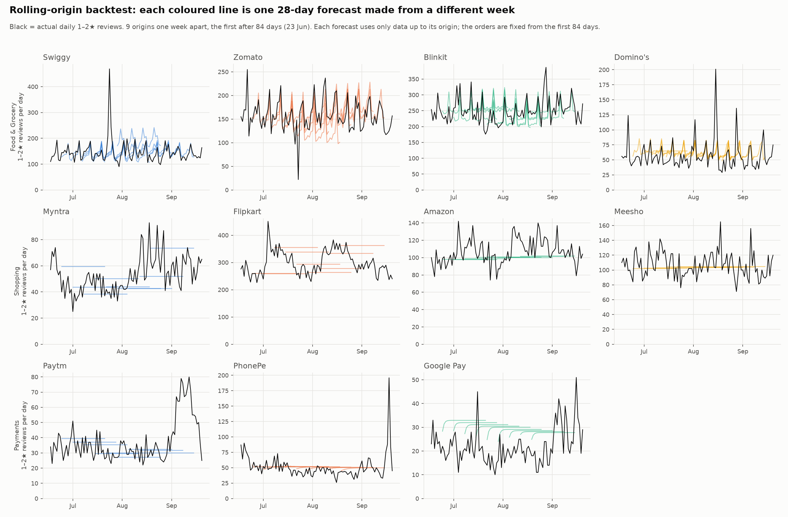
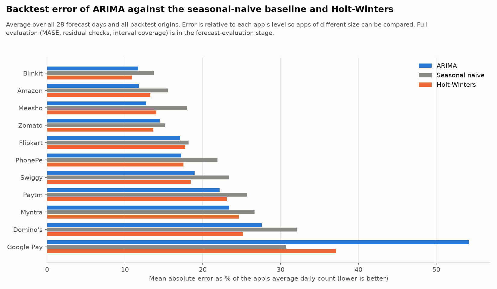
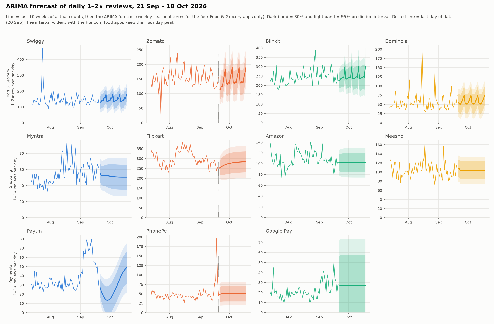
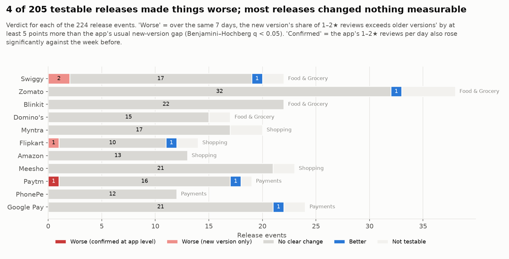
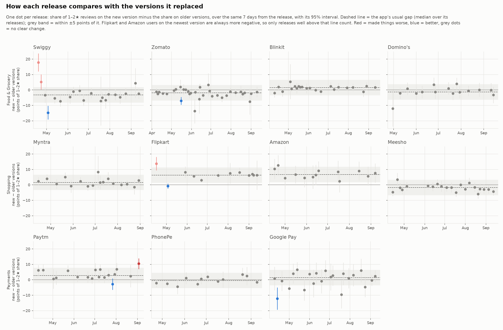
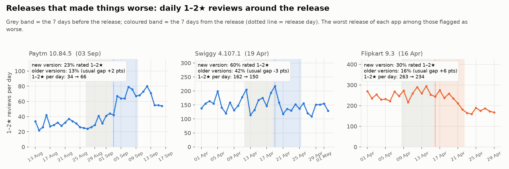
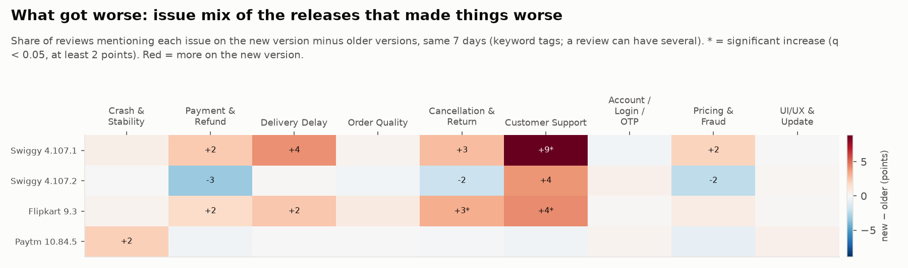

# Time-Series Analysis — Review 2, Method 2

**Capstone Project — Review 2 (Unit 3): Time-Series Analysis**
_Input: `data/tagged/<app>.csv.gz` (1,137,987 reviews, 11 apps, 1 Apr – 20 Sep 2026)_

The question: how many 1–2★ reviews will each app get in the coming weeks, and did a new app version make things worse? This document grows stage by stage: data preparation (#131), ARIMA forecasting (#135), forecast evaluation (#137) and update impact (#138).

---

## 1. Data preparation (#131)

Code: `scripts/15_time_series_data.py` (about 10 seconds). Tables in `data/timeseries/`, charts in `data/charts/timeseries/`, numbers in `data/timeseries_summary.json`.

### 1.1 The series

The modelled series is the **daily count of 1–2★ reviews per app** (173 days, 1 Apr – 20 Sep 2026). Counts are used instead of the share of 1–2★ reviews, because the late-April feed gap removes mostly positive reviews, which distorts shares far more than counts.

| File                                  | Contents                                                                                                                                                     |
| ------------------------------------- | ------------------------------------------------------------------------------------------------------------------------------------------------------------ |
| `daily_app.csv`                       | One row per app per day: reviews, 1–2★ and 4–5★ counts, mean rating, mean sentiment, share of 1–2★, the 9 issue counts, weekday, and the quality flags below |
| `daily_domain.csv`                    | The same, summed per domain                                                                                                                                  |
| `weekly_app.csv`, `weekly_domain.csv` | Monday–Sunday weeks; `complete_week` marks weeks fully inside the window (24 of 25)                                                                          |
| `release_events.csv`                  | One row per app version: first day seen, reviews, rating, share of 1–2★, and whether it counts as a new release                                              |
| `stl_components.csv`                  | STL trend, weekly seasonal and remainder components per app                                                                                                  |
| `patterns_by_app.csv`                 | Trend and seasonal strength, weekday effect, trend change, suggested differencing                                                                            |
| `stationarity.csv`                    | ADF tests on the level, the first difference, the weekly difference and both                                                                                 |
| `acf_pacf.csv`                        | ACF and PACF for lags 0–28, for the level and the weekly difference                                                                                          |

### 1.2 Data-quality flags

| Flag                            | Meaning                                                                                                                                                                  | How to use it                                                                                                                                                                                              |
| ------------------------------- | ------------------------------------------------------------------------------------------------------------------------------------------------------------------------ | ---------------------------------------------------------------------------------------------------------------------------------------------------------------------------------------------------------- |
| `feed_gap`                      | 21 Apr – 5 May for Swiggy, Blinkit, Domino's, Flipkart and Amazon (75 app-days). Positive reviews are mostly missing from the Play Store feed; 1–2★ counts fall far less | Pass it to ARIMA as an extra input (SARIMAX) so the model does not read the dip as a real change                                                                                                           |
| `source_gap`, `source_coverage` | Zomato has no reviews from 23 Jul 22:00 to 25 Jul 12:30. Coverage is 0.92, 0 and 0.48 for those three days                                                               | 24 Jul is filled in `neg_reviews_filled` with the mean of the same weekday one and two weeks either side (165.5). 23 and 25 Jul keep their real counts, because reviews arrive in a burst after the outage |
| `neg_reviews_filled`            | `neg_reviews` with only the fully missing Zomato day filled                                                                                                              | Use this column for models; `neg_reviews` stays raw                                                                                                                                                        |

### 1.3 Release events

`app_version` is the version on the reviewer's phone, so the first day a version appears marks its rollout. 2,507 versions appear in the reviews; 558 have at least 30 reviews. A version counts as a **new release** (`use_for_update_impact`) only if it:

1. has at least 30 reviews;
2. first appears after 1 Apr (a version already present on 1 Apr was released earlier); and
3. is numbered higher than every version seen before it. This removes old builds that some users still run, which otherwise appear as "new" late in the window (for example Amazon 12.0 in September).

That leaves **224 release events**, from 12 (PhonePe) to 38 (Zomato) per app. `first_seen_10th_review` gives a date that ignores a few early-access reviews. Chart: `ts_04_release_events.png`.

### 1.4 Time-based patterns

**Levels and trend** (`ts_01_daily_negative_reviews.png`, `ts_02_stl_trend.png`). Flipkart (282 a day) and Blinkit (251) get the most 1–2★ reviews; Google Pay the fewest (27). Comparing the first and last four weeks (gap days excluded), Paytm rises most (+60%, a September jump) and Myntra (+22%), Amazon (+14%) and Blinkit (+13%) also rise, while Google Pay (−20%), Domino's (−18%), Swiggy (−16%) and Zomato (−11%) fall. The STL trend is strongest for Flipkart (strength 0.81), Paytm (0.67) and Myntra (0.60). The series also show short spikes, such as Swiggy in late July and Google Pay in mid-May, which a forecast should flag rather than predict.

**Weekly pattern** (`ts_03_weekday_effect.png`). Food apps get clearly more complaints on **Sundays**: Domino's +38%, Swiggy +28%, Zomato +28% and Blinkit +22% against their weekly mean, and fewer early in the week. Shopping apps have no real weekday pattern (within ±6%). Payment apps vary a little more: Google Pay +11% on Mondays and Thursdays and −11% on Saturdays, PhonePe −9% on Sundays. Seasonal strength from STL is 0.41–0.56 for Zomato and Blinkit and below 0.27 elsewhere.

**Stationarity** (`stationarity.csv`). The ADF test (lag length chosen by AIC) rejects a unit root at 5% for the level of 9 of 11 apps. Zomato (p = 0.066) and Blinkit (p = 0.094) are not stationary in level; after a first or weekly difference every app is stationary (p < 0.03).

**Autocorrelation** (`acf_pacf/<app>.png`, `acf_pacf.csv`). Lag-1 autocorrelation is 0.14 (Meesho) to 0.82 (Flipkart). Zomato and Blinkit have clear weekly spikes (ACF at lag 7: 0.43 and 0.50; at lag 14: 0.33 and 0.29); Flipkart, Myntra and Paytm show slow decay, which matches their stronger trend. The 95% limits are ±0.149.

### 1.5 Starting points for the ARIMA models (#135)

|                               | Suggestion                                                                        | Why                                                |
| ----------------------------- | --------------------------------------------------------------------------------- | -------------------------------------------------- |
| Series                        | `neg_reviews_filled` per app                                                      | Raw counts with only the missing Zomato day filled |
| d (non-seasonal differencing) | 1 for Zomato and Blinkit, 0 for the rest (`suggested_d`)                          | ADF on the level                                   |
| D (seasonal differencing)     | 0 for every app (`suggested_D`)                                                   | STL seasonal strength is below 0.64 everywhere     |
| Seasonal terms                | Try a seasonal AR or MA term at lag 7 for Zomato, Blinkit and the other food apps | Weekly ACF spikes and the Sunday effect            |
| Extra input                   | `feed_gap` as an exogenous dummy                                                  | The late-April dip for five apps                   |

These are starting points; the orders are chosen in #135 from the ACF/PACF charts and AIC.

---

## 2. ARIMA forecasting with a rolling backtest (#135)

Code: `scripts/19_forecasting.py` (about 1 minute). Tables in `data/timeseries/`, charts `ts_05`–`ts_07` in `data/charts/timeseries/`, numbers in `data/forecasting_summary.json`.

### 2.1 Models

The forecast target is the daily count of 1–2★ reviews per app (`neg_reviews_filled`, 173 days). Three models are fitted at every step so the main model has something to beat:

| Model                                  | What it does                                                                                                                                                                                                                                                                                                                                                                                     | Intervals   |
| -------------------------------------- | ------------------------------------------------------------------------------------------------------------------------------------------------------------------------------------------------------------------------------------------------------------------------------------------------------------------------------------------------------------------------------------------------ | ----------- |
| **ARIMA / SARIMA** (main)              | ARIMA, with seasonal terms at lag 7 (a weekly cycle, i.e. SARIMA) only for the four Food & Grocery apps (Swiggy, Zomato, Blinkit, Domino's), which have a strong weekday pattern; the other seven apps get a plain ARIMA. For Swiggy, Blinkit, Domino's, Flipkart and Amazon the 0/1 `feed_gap` dummy is an extra input (SARIMAX); it is 0 for every forecast day because the gap is in the past | 80% and 95% |
| **Seasonal naive** (baseline)          | Forecast = the count of the same weekday last week                                                                                                                                                                                                                                                                                                                                               | none        |
| **Holt-Winters** (optional comparison) | Exponential smoothing with a damped additive trend and an additive weekly season                                                                                                                                                                                                                                                                                                                 | none        |

Forecasts and interval limits below zero are set to 0, because counts cannot be negative.

### 2.2 How the orders were chosen (`arima_orders.csv`, `arima_candidates.csv`)

1. **d** comes from an ADF test on the training days (d = 1 when a unit root cannot be rejected at 5%); **D = 0** everywhere (seasonal strength is below 0.64). A constant is included only when d = 0.
2. **ACF/PACF propose.** On the (differenced) training series, p goes up to the last PACF lag outside ±1.96/√n among lags 1–3, q up to the last significant ACF lag among 1–3, and a seasonal AR (or MA) term at lag 7 is tried if the PACF (or ACF) is significant at lag 7 **or** the app has a strong weekday effect on the training days (a weekday 15% or more away from the centred weekly mean; on all 173 days these are the four food apps, +22% to +38% on Sundays). This gives 4 to 36 candidate orders per app.
3. **AICc chooses.** Every candidate is fitted and the lowest corrected AIC wins; any order within 2 AICc points of the minimum counts as equally good and the one with the fewest terms is taken. All 384 candidate fits converged, and every candidate with its AICc is in `arima_candidates.csv`.
4. **No look-ahead.** For the backtest, d, the weekday flag and the orders are all chosen on the **first 84 days only**; for the final forecast they are chosen again on all 173 days. Both choices are in `arima_orders.csv` (`stage` = `backtest` or `final`). On 84 days the ADF test asks for differencing for six apps (Swiggy, Zomato, Blinkit, Myntra, Flipkart, Paytm), on 173 days only for Zomato and Blinkit; a short window often looks non-stationary.

Final orders (p, d, q)(P, 0, Q)₇:

| Domain         | App        | Order          | Notes                                                            |
| -------------- | ---------- | -------------- | ---------------------------------------------------------------- |
| Food & Grocery | Swiggy     | (0,0,1)(1,0,1) | seasonal AR and MA at lag 7; feed-gap input                      |
|                | Zomato     | (2,1,1)(1,0,1) | differenced once                                                 |
|                | Blinkit    | (1,1,1)(1,0,1) | differenced once; feed-gap input                                 |
|                | Domino's   | (0,0,1)(1,0,1) | seasonal terms because of its +38% Sunday effect; feed-gap input |
| Shopping       | Myntra     | (3,0,2)        |                                                                  |
|                | Flipkart   | (1,0,1)        | strong trend, handled by the AR term; feed-gap input             |
|                | Amazon     | (1,0,1)        | feed-gap input                                                   |
|                | Meesho     | (0,0,2)        |                                                                  |
| Payments       | Paytm      | (2,0,2)        |                                                                  |
|                | PhonePe    | (1,0,0)        |                                                                  |
|                | Google Pay | (1,0,0)        |                                                                  |

The four food apps are the only ones with seasonal terms, which matches the Sunday peak found in Stage 1. Shopping and payment apps need only short-memory terms.

### 2.3 Rolling-origin backtest (`backtest_forecasts.csv`, `backtest_summary.csv`, `ts_06_rolling_backtest.png`)

The models are fitted on the first 84 days (12 weeks), forecast the next 28 days, then the origin moves one week forward and every model is refitted: **9 origins** (23 Jun to 18 Aug), each with a 28-day forecast, so 252 forecast days per app and model. Every row of `backtest_forecasts.csv` has the origin, the horizon (1–28 days), the actual count, the forecast and, for ARIMA, the 80% and 95% limits. Stage 4 (#137) uses this table for MASE, residual checks, interval coverage and unusual-day alerts.

### 2.4 Comparison with the baseline (`ts_07_backtest_mae_vs_baseline.png`)

Mean absolute error over all 28 forecast days, in reviews per day (lower is better; best per app in bold):

| App        |    ARIMA | Seasonal naive | Holt-Winters |
| ---------- | -------: | -------------: | -----------: |
| Swiggy     |     28.1 |           34.6 |     **27.4** |
| Zomato     |     22.8 |           23.9 |     **21.5** |
| Blinkit    |     28.8 |           33.8 |     **26.8** |
| Domino's   |     15.8 |           18.3 |     **14.4** |
| Myntra     | **12.2** |           13.9 |         12.8 |
| Flipkart   | **52.7** |           56.0 |         54.7 |
| Amazon     | **12.9** |           16.9 |         14.5 |
| Meesho     | **13.6** |           19.3 |         15.1 |
| Paytm      |  **7.6** |            8.8 |          7.9 |
| PhonePe    |  **7.9** |           10.0 |          8.0 |
| Google Pay |     10.9 |        **6.2** |          7.5 |

- **ARIMA beats the seasonal-naive baseline for 10 of 11 apps.** The largest gains are for Meesho (−29%), Amazon (−24%), PhonePe (−21%) and Swiggy (−19%).
- **It does not beat the baseline for Google Pay.** Google Pay has a low, noisy level with short spikes (mid-May and September) and its level shifts, so a model that returns to the training mean is a poor guide, while last week's value adapts faster. ARIMA forecasts about 30 a day on average while the actual level over the backtest was about 20.
- **ARIMA and Holt-Winters are about equally accurate.** ARIMA is better for 6 apps (Amazon, Flipkart, Meesho, Myntra, Paytm, PhonePe), Holt-Winters for the four Food & Grocery apps. ARIMA stays the main model because it is the only one with prediction intervals (needed for the unusual-day alerts and for capacity planning) and because it takes the feed gap as an input.
- Error grows with the horizon for Flipkart (ARIMA 32.0 in days 1–7, 59.2 in days 15–28): with the orders chosen on 84 days its series is differenced, so a forecast follows the last level, and Flipkart's level moved during the backtest.

### 2.5 Formal forecast evaluation and unusual-day alerts (#137)

The rolling-origin backtest is evaluated with mean absolute error (MAE), root mean squared error (RMSE), mean absolute scaled error (MASE) and the MAE relative to the seasonal-naive forecast. For MASE each error is divided by the in-sample error of "same weekday last week" on the training window of its own origin (Hyndman and Koehler, 2006). The relative MAE compares the models on exactly the same backtest days: below 1 means the model beats the baseline. The two can disagree: Google Pay's MASE is 0.64, because its training windows were noisier than the backtest days, yet its relative MAE is 1.76, so the baseline wins. Lower is better for all four.

**Overall model comparison** (unweighted means over the 11 apps, reviews per day):

| Model | MAE | RMSE | MASE | MAE ÷ seasonal-naive MAE | Beats the baseline |
|---|---:|---:|---:|---:|---|
| ARIMA / SARIMA | 19.39 | 26.74 | 0.93 | 0.93 | 10 of 11 apps |
| Holt-Winters | 19.14 | 26.66 | 0.93 | 0.88 | 10 of 11 apps |
| Seasonal naive | 21.99 | 31.07 | 1.08 | 1.00 | – |

ARIMA and Holt-Winters are equally accurate on average and both clearly beat the baseline; Google Pay is the exception for both. ARIMA is kept as the main model for its prediction intervals and the feed-gap input.

**Prediction-interval coverage.** Across the 2,772 ARIMA backtest forecast rows, the 80% intervals contained 82.7% of the actual counts and the 95% intervals 93.9%, close to their nominal levels. By app the 95% coverage ranges from 85.7% (Amazon) to 100% (Google Pay); the four shopping apps are lowest (Amazon 85.7%, Meesho 88.5%, Myntra 88.9%, Flipkart 92.9%), so their intervals are somewhat too narrow and they raise more alerts. Because rolling forecast windows overlap, these observations are not independent; coverage is a descriptive backtest measure rather than an independent-sample calibration test.

**Residual diagnostics.** Ljung–Box tests were applied to the final fitted ARIMA/SARIMAX residuals at lag 14. All 11 apps had p-values above 0.05, so the tests did not detect statistically significant residual autocorrelation at that lag. This does not prove that residuals are fully random or that the models capture every pattern.

**Unusual-day alerts.** A forecast row was flagged when its observed negative-review count fell outside the ARIMA 95% prediction interval. The evaluation produced 169 flagged forecast rows on 77 distinct app-days (56 above the interval, 21 below). Since multiple rolling origins can forecast the same app and calendar day, the unique app-day summary is used to distinguish individual unusual days from repeated alerts for the same event. For example, Swiggy's 23–25 July spike (469 1–2★ reviews on 24 July) was flagged by four forecast origins. Alerts come from forecasts 1 to 28 days ahead, so a lasting level shift raises several in a row (Paytm: 10 days from 4 September). Such alerts indicate unexpected observations, not proof that an app update or a particular event caused the spike.

Evaluation outputs are saved under `data/timeseries/`: `evaluation_metrics_by_app.csv`, `evaluation_metrics_by_horizon.csv`, `prediction_interval_coverage.csv`, `residual_diagnostics.csv`, `residual_acf.csv`, `unusual_day_alerts.csv` and `unusual_days_unique.csv`. The associated charts are `ts_08_evaluation_mae.png`, `ts_09_interval_coverage.png` and `ts_10_residual_acf.png` in `data/charts/timeseries/`.

### 2.6 Forecast for 21 Sep – 18 Oct 2026 (`forecast_daily.csv`, `forecast_weekly.csv`, `ts_05_forecast_next_4_weeks.png`)

The final models are fitted on all 173 days and forecast four Monday–Sunday weeks. `forecast_daily.csv` has the daily forecast of all three models (ARIMA with 80% and 95% limits); `forecast_weekly.csv` has the weekly totals, whose intervals come from 2,000 simulated future paths of the ARIMA model.

Expected number of 1–2★ reviews in the first forecast week (21–27 Sep), with the 80% interval and the average of the last four weeks of data:

| App        | Week 1 forecast | 80% interval  | Last 4 weeks (weekly average) |
| ---------- | --------------: | ------------- | ----------------------------: |
| Flipkart   |           1,830 | 1,596 – 2,056 |                         1,973 |
| Blinkit    |           1,711 | 1,488 – 1,929 |                         1,849 |
| Swiggy     |           1,037 | 889 – 1,180   |                           973 |
| Zomato     |             977 | 811 – 1,151   |                         1,054 |
| Meesho     |             737 | 676 – 801     |                           712 |
| Amazon     |             714 | 642 – 786     |                           758 |
| Domino's   |             413 | 327 – 495     |                           386 |
| Myntra     |             371 | 318 – 424     |                           414 |
| PhonePe    |             348 | 270 – 431     |                           385 |
| Google Pay |             192 | 105 – 310     |                           187 |
| Paytm      |             136 | 75 – 205      |                           348 |

How to read it:

- **Food apps keep their weekly shape**: Zomato, Blinkit, Swiggy and Domino's forecasts peak on Sundays, as the seasonal terms learned (Domino's: about 75 on Sundays against about 50–52 on Tuesdays and Wednesdays).
- **Shopping and payment apps are nearly flat**: with no seasonality the forecast returns to a level within days, and the interval carries the uncertainty. Flipkart's forecast rises slowly from 252 to 284 a day.
- **Intervals are wide for noisy apps.** Google Pay's 95% daily interval is about 0–74 for a forecast of 27, and Swiggy's reaches about 250 against a forecast of 130–180, because of the short spikes in the training data. The intervals are an honest statement that single days cannot be predicted well; weekly totals are much better determined.
- **Paytm is the one forecast to treat with care.** Paytm jumped from about 30 to 80 a day in September and fell back to 25 on 20 Sep. The (2,0,2) model fitted on that shape swings below the long-run mean first (forecast 136 in week 1, −61% against the last four weeks) and then back up. `forecast_weekly.csv` carries `change_vs_last_4_weeks_pct`, and `forecasting_summary.json` lists Paytm under `large_week1_changes`. Treat this app's forecast as unreliable until the September level shift is explained; the forecast-evaluation stage should flag it.

### 2.7 Outputs for the next stages

| Used by                                                     | Files                                                                                        |
| ----------------------------------------------------------- | -------------------------------------------------------------------------------------------- |
| Forecast evaluation and write-up (#137, #142)               | `backtest_forecasts.csv`, `backtest_summary.csv`, `arima_orders.csv`, `arima_candidates.csv` |
| Dashboard forecasting page and recommendations (#140, #141) | `forecast_daily.csv`, `forecast_weekly.csv`, `forecasting_summary.json`                      |

### 2.8 Limits

- Only 173 days are available, so there is no yearly pattern and the backtest has just 9 origins; the first origin already needs 84 days.
- The series are counts of reviews, which depend on app traffic and campaigns that the model does not see. The forecast answers "what if the next weeks look like the recent past", not "what will a campaign do".
- Level shifts and spikes (Paytm in September, Swiggy in late July) are not predictable by ARIMA; they widen the intervals instead.
- The forecast does not include release dates. Whether a new version raises the count is the question of the update-impact stage (#138).

---

## 3. Update impact before and after each app version (#138)

Code: `scripts/21_update_impact.py` (about 10 seconds; needs `scripts/15_time_series_data.py` and `scripts/20_forecast_evaluation.py` first). Tables in `data/update_impact/`, charts in `data/charts/update_impact/`, numbers in `data/update_impact_summary.json`.

The question: after each new app version, did 1–2★ reviews, the rating or the issue mix get worse, and is the change larger than chance?

### 3.1 Method

Each of the 224 release events in `release_events.csv` (rows with `use_for_update_impact`) is tested. The release day is the day the version reached its 10th review (`first_seen_10th_review`), so a handful of early testers does not start the window.

Two views are compared:

| View | Comparison | Tests |
| ---- | ---------- | ----- |
| A. Before vs after (app level) | The app's reviews in the 7 days before the release vs the 7 days from the release | Welch t-test on 1–2★ reviews per day; two-proportion z-test on the 1–2★ share; Welch t-test on the rating |
| B. New vs older versions (main test) | Over the same 7 days from the release, reviews written on the new version vs reviews on older versions | Two-proportion z-test on the 1–2★ share, Wald 95% interval; per-issue z-tests on the nine keyword issue flags |

View B is the main test because both groups cover the same days, so weekends, sales and outages affect both equally. View A alone cannot separate a release from whatever else happened that week.

**Usual new-version gap.** Users on the newest version are not a random sample: on Flipkart and Amazon they are always about 6 points more negative than users on older versions, release after release. A raw "new minus older" test flagged 23 releases, 9 of them Flipkart's. Each release is therefore compared with its own app's usual gap (the median over the app's other releases, leave-one-out), and the test is on the excess:

- **Worse** = excess over the usual gap of at least 5 points and Benjamini–Hochberg q < 0.05 across all releases.
- **Worse (confirmed at app level)** = also a significant rise in 1–2★ reviews per day in View A (q < 0.05), outside the late-April feed gap.
- **Better** = excess of at most −5 points and q < 0.05.
- **Not testable** = the 7-day windows are not fully inside the data, or fewer than 30 reviews on either version.
- An issue counts as elevated when its share on the new version is at least 2 points higher with q < 0.05.

Usual gaps by app (points of 1–2★ share, new minus older): Amazon +6.7, Flipkart +6.3, Paytm +2.7, Myntra +1.6, Blinkit +1.6, Google Pay +1.4, PhonePe −0.5, Domino's −1.3, Meesho −1.7, Zomato −1.8, Swiggy −3.2.

### 3.2 Results (`release_impact.csv`, `impact_by_app.csv`, `01_release_verdicts_by_app.png`, `02_release_effects.png`)

| Verdict | Releases |
| ------- | -------: |
| Worse (confirmed at app level) | 1 |
| Worse (new version only) | 3 |
| No clear change | 196 |
| Better | 5 |
| Not testable (16 outside the data, 3 with too few reviews) | 19 |
| **Total** | **224** |

Most releases change nothing measurable: 196 of the 205 testable releases (96%) are within chance of the app's usual gap, and the median gap is +0.25 points. Only one release raised an app's 1–2★ reviews per day significantly against the week before.

### 3.3 Releases that made things worse (`worse_releases.csv`, `03_worst_release_examples.png`, `04_issue_mix_of_worse_releases.png`)

| App | Version | Release day | 1–2★ share new vs older | Usual gap | Excess | q | 1–2★ per day before → after | Elevated issue | Verdict |
| --- | ------- | ----------- | ----------------------- | --------: | -----: | -: | --------------------------- | -------------- | ------- |
| Swiggy | 4.107.1 | 19 Apr | 60% vs 42% | −3.3 | +21.2 | < 0.001 | 162 → 150 | Customer Support +8.9 | New version only |
| Swiggy | 4.107.2 | 23 Apr | 88% vs 83% | −3.3 | +8.5 | 0.015 | 163 → 137 | – | New version only |
| Paytm | 10.84.5 | 3 Sep | 23% vs 13% | +2.4 | +8.1 | < 0.001 | 34 → 66 (q = 0.027) | – | **Confirmed at app level** |
| Flipkart | 9.3 | 16 Apr | 30% vs 16% | +6.2 | +7.6 | 0.015 | 263 → 234 | Customer Support +4.2, Cancellation & Return +3.2 | New version only |

Per app:

- **Paytm 10.84.5 is the clearest bad release.** Its users were 10 points more negative than users still on older versions (23% vs 13% 1–2★; average rating 3.95 vs 4.41), 8 points beyond Paytm's usual gap, and the whole app's 1–2★ reviews per day nearly doubled (34 → 66). The forecast-evaluation stage (#137) independently raised 6 alerts above the 95% interval in the week after this release. It explains part of Paytm's September jump and the unreliable Paytm forecast in §2.6. No single keyword issue rose significantly, so the complaints are spread across issues.
- **Swiggy 4.107.1 and 4.107.2** had much more negative users than older versions in the same days (+21 and +8.5 points beyond the usual gap), with Customer Support complaints up 8.9 points on 4.107.1. Both fall in the 21 Apr – 5 May feed gap, when the feed over-samples negative reviews (shares of 60–88%), so the size of the effect is uncertain; the comparison is still fair because both groups cover the same days. App-level counts did not rise.
- **Flipkart 9.3** was 7.6 points worse than Flipkart's usual gap, with more Customer Support and Cancellation & Return complaints; it is also in the feed gap. Later Flipkart versions (9.5, 9.6, 9.13) also show significant small rises in Customer Support mentions (+2 to +3 points) without crossing the 5-point rule.
- **No release made things worse** for Zomato, Blinkit, Domino's, Myntra, Amazon, Meesho, PhonePe or Google Pay.

**Better releases (5):** Swiggy 4.108.0 (36% vs 50%, the version after the bad ones), Zomato 19.6.3 (16% vs 23%), Flipkart 9.4, Paytm 10.83.9 and Google Pay 327.1.1. Swiggy 4.108.0 replaced the two worse Swiggy versions.

**Robustness.** With the release day set to the first review on the version (`first_seen`) instead of the 10th, 202 releases are testable and the same 4 releases are flagged.

### 3.4 Outputs for the next stages

| Used by | Files |
| ------- | ----- |
| Combined insights and recommendations (#141) | `worse_releases.csv`, `impact_by_app.csv`, `release_impact.csv` |
| Dashboard update-impact page (#140) | `release_impact.csv`, `release_issue_changes.csv`, `impact_by_app.csv` |

### 3.5 Limits

- Users choose when to update. Early updaters can differ from late ones, which is why each release is compared with the app's usual gap instead of zero; the remaining bias is unknown.
- Three of the four worse releases fall in the late-April feed gap, so their shares are inflated; only Paytm 10.84.5 is confirmed by app-level counts outside the gap.
- A 1–2★ review is the user's judgement, not a confirmed defect, and the issue mix uses keyword tags, which miss complaints worded differently.
- Releases close together (Swiggy 4.107.1 and 4.107.2, four days apart) have overlapping windows, so their effects cannot be fully separated.
- Release dates come from the reviews themselves (`app_version`), not from the stores' release notes, so a staged rollout appears on the day it reached 10 reviews.
